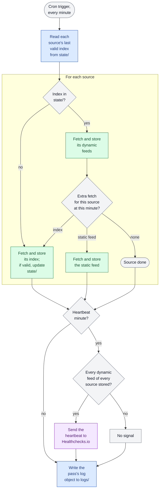

# Architecture

Solution architecture of the Barcelona bike sharing data platform, following the [arc42](https://arc42.org/overview) template. It states what holds today; each decision updates its section when it is taken.

## 1. Introduction and goals

A data platform on public bike sharing in the Barcelona area: it captures the AMBici and Bicing open data, unifies both providers in one model and serves it for analysis and visualization. It is a data engineering portfolio project. [d002 › Context](designs/d002-requirements.md#context); [ADR-0002](decisions/0002-data-sources-ambici-and-bicing.md); [ADR-0040](decisions/0040-model-vocabulary-from-gbfs-3-0.md).

### 1.1 Requirements overview

The platform answers the guiding questions below, each comparable across services (AMBici, Bicing). Must is the minimum and the first vertical slice; storage, engine, execution target and visualization (T035–T038) are sized against Must, Should and Could. Window is the period gold must answer. [d002 › Guiding questions](designs/d002-requirements.md#guiding-questions).

| Priority | # | Question | Grain | Window | Freshness | Source |
|---|---|---|---|---|---|---|
| Must | Q1 | How many bikes and free docks does each station have right now? | Snapshot | Latest | ≤ 5 min | [d002 › Q1](designs/d002-requirements.md#guiding-questions) |
| Must | Q2 | Do the feeds arrive on time and complete? | Minute | 30 days | ≤ 5 min | [d002 › Q2](designs/d002-requirements.md#guiding-questions) |
| Must | Q3 | When is each station full or empty, and for how long? | Hour | 12 months | 1 hour | [d002 › Q3](designs/d002-requirements.md#guiding-questions) |
| Should | Q4 | How many trips are made per day, by municipality and post code? | Day | 12 months | 1 hour | [d002 › Q4](designs/d002-requirements.md#guiding-questions) |
| Should | Q5 | What share of the fleet is in use right now? | Snapshot | Latest | ≤ 5 min | [d002 › Q5](designs/d002-requirements.md#guiding-questions) |
| Should | Q6 | Which stations are used most and least? | Day | 12 months | 1 day | [d002 › Q6](designs/d002-requirements.md#guiding-questions) |
| Could | Q7 | Which stations and zones act as sources or sinks by time band? | Hour | 12 months | 1 hour | [d002 › Q7](designs/d002-requirements.md#guiding-questions) |
| Could | Q8 | How has the station network changed over time? | Change event | Since the earliest archive loaded | 1 day | [d002 › Q8](designs/d002-requirements.md#guiding-questions) |

**Won't (now):** rebalancing, outages, trend since 2019, correlation at border stations, spatial clusters, 300 m coverage, anomalies, estimated origin-destination matrix (AMBici's battery levels could narrow it). [d002 › Guiding questions](designs/d002-requirements.md#guiding-questions); [d005 › D3](designs/d005-data-model.md#d3-feeds-that-enter-the-model).

Functional requirements:

- **Public visualization:** read-only and publicly accessible, without login. [d002 › R1](designs/d002-requirements.md#requirements).
- **Bicing history:** the monthly archives covering the 12 months before the first load are loaded once. [d002 › R5](designs/d002-requirements.md#requirements).
- **Capture:** dynamic feeds every minute, static feeds once a day, staggered; responses requested gzip-compressed from the origin and stored unchanged; a pass for all feeds needs a few milliseconds of CPU. [s006](spikes/s006-cloudflare-capture.md).

### 1.2 Quality goals

| Priority | Quality goal | Characteristic | Motivation | Source |
|---|---|---|---|---|
| 1 | Current station status is recent, and stale data is never shown as current | Currentness (ISO/IEC 25012) | Live station status (Q1) is the visualization's main view | [d002 › R3, R7](designs/d002-requirements.md#requirements) |
| 2 | Silver and gold can be caught up and rebuilt from bronze | Recoverability (ISO/IEC 25010) | Stops and model changes must not lose data | [d002 › R11, R13](designs/d002-requirements.md#requirements) |
| 3 | Each component and user reaches only the data and access its role needs, and data that cannot be rebuilt cannot be deleted or altered | Confidentiality, Integrity (ISO/IEC 25010) | Data and services run in the cloud, and the visualization is open to the public | [d002 › R1, R15–R22](designs/d002-requirements.md#requirements) |
| 4 | Every gap is recorded and attributed to its cause | Completeness (ISO/IEC 25012) | Measures derived from consecutive counts are only trustworthy when their gaps are known | [d002 › R9, R14](designs/d002-requirements.md#requirements) |

Each goal is made measurable by the scenarios in §10.

### 1.3 Stakeholders

| Role | Expectations | Source |
|---|---|---|
| Owner | Builds and operates the platform; is alerted when capture stops, a pipeline run fails or cost is forecast over budget | [d002 › R8, R10, R23](designs/d002-requirements.md#requirements) |
| Portfolio reviewers | Data engineering skills shown in practice: near-real-time capture, batch archive loading, medallion layers, industry standards | [d002 › Context](designs/d002-requirements.md#context) |
| Public visitors | Current and historical station data, without login | [d002 › R1](designs/d002-requirements.md#requirements) |
| Data publishers ([AMBici](sources/ambici.md), [Bicing](sources/bicing.md)) | Attribution as each licence requires | [d002 › R2](designs/d002-requirements.md#requirements) |

## 2. Constraints

| Constraint | Type | Background | Source |
|---|---|---|---|
| Running cost below €10 per month; free tiers preferred when options tie | Organisational | Portfolio project funded by the owner | [d002 › R4](designs/d002-requirements.md#requirements); [d002 › Context](designs/d002-requirements.md#context) |
| Monthly budget shares: capture €0, storage €2, pipeline €4, visualization €2, reserve €2 | Organisational | Each component is sized against its share; one that exceeds it reopens the split against the reserve | [ADR-0026](decisions/0026-budget-shares-per-component.md) |
| Licence attribution shown in the visualization | Legal | Required by each source's licence | [d002 › R2](designs/d002-requirements.md#requirements) |
| Single-node engines only | Technical | Distributed engines such as Spark are oversized for the volume (§3) | [tasks.md › T036](tasks.md) |
| Station or zone-level aggregates only | Technical | Bike IDs rotate after each trip, so a bike cannot be tracked | [d002 › Guiding questions](designs/d002-requirements.md#guiding-questions); [AMBici › Known characteristics](sources/ambici.md#known-characteristics) |

## 3. Context and scope

- **Sources:** AMBici and Bicing GBFS feeds. AMBici publishes no history; Bicing does. [ADR-0002](decisions/0002-data-sources-ambici-and-bicing.md); [s004](spikes/s004-bicing-historical-data.md).
- **Volume:** about 90 MB/day compressed and about 5,700 objects/day at a 1-minute interval, about 33 GB/year (measured 2026-10-14 to 2026-10-24). [AMBici › Feeds](sources/ambici.md#feeds); [Bicing › Resources](sources/bicing.md#resources).
- **Consumers:** public visitors read the visualization; the owner receives the operational alerts (§1.3). [d002 › R1, R8, R10](designs/d002-requirements.md#requirements).

## 4. Solution strategy

### 4.1 Technology

- **Own lakehouse on Cloudflare R2:** every layer is stored as open-format files in R2, with compute separate; R2 charges no egress, so the engine can run anywhere. Silver and gold are Delta Lake tables, whose commits are safe on R2 with no external lock. [ADR-0019](decisions/0019-own-lakehouse-on-cloudflare-r2.md); [ADR-0022](decisions/0022-delta-lake-for-silver-and-gold.md).
- **DuckDB as the processing engine:** an in-process, single-node engine that reads bronze and Delta from R2, and hands writes and MERGE to `deltalake` through Arrow; Polars is the fallback. [ADR-0024](decisions/0024-duckdb-as-processing-engine.md).
- **SQL models directed by Python:** transformations are `.sql` models that the engine executes; Python runs them in order and hands results to `deltalake`. [ADR-0025](decisions/0025-sql-models-directed-by-python.md).
- **Modal as the execution platform:** the pipeline runs on Modal's Starter plan, fully managed and at no cost within its monthly credit, so one operator keeps no machine; Oracle Cloud Always Free is the fallback. [ADR-0027](decisions/0027-modal-as-execution-platform.md).
- **Modal's Cron as the scheduler:** the platform's native schedule triggers each run, with no added component and fixed clock times. [ADR-0028](decisions/0028-modal-cron-as-pipeline-scheduler.md).

### 4.2 Structure

- **Thin platform wrapper:** the pipeline's package knows nothing about the platform; one module outside it declares what the platform needs and calls a single entry point, and configuration arrives as environment variables. [ADR-0029](decisions/0029-pipeline-code-architecture.md).
- **Landing zone with an output contract:** every collector writes the same key layout, UTC capture time and origin bytes; the pipeline depends only on the files, so collectors can change tool or language. [ADR-0012](decisions/0012-collectors-decoupled-by-output-contract.md).
- **Raw kept untouched:** source responses are stored as received, so everything downstream can be reprocessed from them, since bronze is kept indefinitely. [ADR-0006](decisions/0006-raw-layer-keeps-source-responses-untouched.md); [ADR-0021](decisions/0021-retention-per-layer.md).
- **Medallion layers:** bronze holds the captured objects and history archives as they arrive, with no table over them, silver the cleaned and conformed common model, gold the tables modelled for the guiding questions; silver and gold can be rebuilt from bronze. [d002 › R6, R13](designs/d002-requirements.md#requirements); [ADR-0018](decisions/0018-medallion-architecture.md); [ADR-0020](decisions/0020-bronze-as-captured-objects.md).

### 4.3 Data model

- **One common model:** both providers are unified in one dimensional model, whose measures take their names and definitions from GBFS 3.0, and built together, since the model exists to join them. [ADR-0040](decisions/0040-model-vocabulary-from-gbfs-3-0.md).
- **Inventory model (Kimball):** stations are stores and bikes are stock; every measure derives from two base facts, the stock snapshot (semi-additive) and the movements derived from consecutive snapshots (additive). [d002 › Guiding questions](designs/d002-requirements.md#guiding-questions).

### 4.4 Visualization

- **Static web page with prepared files:** visitors download files prepared for the page, so no server runs and no visit reads gold, which stays private; Streamlit on Community Cloud is the fallback. [ADR-0032](decisions/0032-static-web-page-for-visualization.md).

### 4.5 Organisation

- **Decisions in dependency order:** each one is taken when the next step needs it (§9). [GitHub Issues](https://github.com/markciano/bikesharing/issues).

## 5. Building block view

| Block | Responsibility | State | Source |
|---|---|---|---|
| Capture | Fetches the feeds and writes them to the landing zone | Built on Cloudflare Workers + R2 | [ADR-0011](decisions/0011-cloudflare-workers-r2-for-realtime-capture.md); [ADR-0019](decisions/0019-own-lakehouse-on-cloudflare-r2.md) |
| Landing zone (bronze) | Holds raw responses under the output contract, and the history archives as downloaded | Bronze bucket in R2 | [ADR-0012](decisions/0012-collectors-decoupled-by-output-contract.md); [ADR-0020](decisions/0020-bronze-as-captured-objects.md); [ADR-0023](decisions/0023-storage-security-baseline.md) |
| Processing | Turns raw responses into the common model and its tables, and publishes the page's prepared files | DuckDB as the engine, with SQL models directed by Python, running on Modal | [ADR-0040](decisions/0040-model-vocabulary-from-gbfs-3-0.md); [ADR-0024](decisions/0024-duckdb-as-processing-engine.md); [ADR-0025](decisions/0025-sql-models-directed-by-python.md); [ADR-0027](decisions/0027-modal-as-execution-platform.md); [ADR-0033](decisions/0033-data-published-by-redeploying-static-assets.md) |
| Lakehouse | Silver and gold tables, read by analysis and by the pipeline to prepare the page's files | Delta tables in the lakehouse bucket in R2; built by the pipeline | [ADR-0019](decisions/0019-own-lakehouse-on-cloudflare-r2.md); [ADR-0022](decisions/0022-delta-lake-for-silver-and-gold.md); [ADR-0023](decisions/0023-storage-security-baseline.md); [ADR-0033](decisions/0033-data-published-by-redeploying-static-assets.md) |
| Visualization | Presents the data | Static web page with JavaScript that downloads prepared files | [d002 › R1, R2](designs/d002-requirements.md#requirements); [ADR-0032](decisions/0032-static-web-page-for-visualization.md) |

## 6. Runtime view

### 6.1 Capture pass

| Step | What happens | Source |
|---|---|---|
| 1 | A Cron Trigger starts the Worker every minute | [ADR-0011](decisions/0011-cloudflare-workers-r2-for-realtime-capture.md); [d004 › D3](designs/d004-bronze-data-capture.md#d3-feed-cadence) |
| 2 | The pass reads each source's last valid index from `state/`; a source without one fetches only its index in this pass | [d004 › D5, D8](designs/d004-bronze-data-capture.md#d5-hourly-index-refresh) |
| 3 | The Worker fetches the dynamic feeds of each source, asking for gzip, and stores each response unchanged in the bronze bucket, under the output contract's key; an existing key is never overwritten | [ADR-0006](decisions/0006-raw-layer-keeps-source-responses-untouched.md); [ADR-0012](decisions/0012-collectors-decoupled-by-output-contract.md); [d004 › D3](designs/d004-bronze-data-capture.md#d3-feed-cadence); [d004 › Write-once](designs/d004-bronze-data-capture.md#write-once) |
| 4 | At fixed minutes the pass makes at most one extra fetch: a source's index, refreshed hourly and kept in `state/` when valid, or a static feed, hourly or daily | [d004 › D4, D5](designs/d004-bronze-data-capture.md#d4-static-feeds-spread-across-passes) |
| 5 | At the heartbeat minute, the pass signals Healthchecks.io only if every dynamic feed of every source was stored | [d004 › D10](designs/d004-bronze-data-capture.md#d10-capture-heartbeat) |
| 6 | The pass writes its log object to `logs/` last, whatever happened before; a failure at any step is logged and does not stop the rest of the pass | [ADR-0036](decisions/0036-log-convention-across-components.md); [d004 › D8, D9](designs/d004-bronze-data-capture.md#d8-capture-failure-behaviour) |

Colours show what each box touches: grey, no I/O; blue, R2 only; green, a source fetch stored in R2; purple, Healthchecks.io. [d004 › Architecture](designs/d004-bronze-data-capture.md#23-architecture).

### 6.2 Pipeline run

| Step | What happens | Source |
|---|---|---|
| 1 | Modal's `Cron` starts a container from the pinned image, with credentials as environment variables | [ADR-0027](decisions/0027-modal-as-execution-platform.md); [ADR-0028](decisions/0028-modal-cron-as-pipeline-scheduler.md); [ADR-0029](decisions/0029-pipeline-code-architecture.md) |
| 2 | The platform module calls the package's entry point, which signals the start to the monitor | [ADR-0029](decisions/0029-pipeline-code-architecture.md); [ADR-0031](decisions/0031-heartbeat-alerts-for-the-pipeline.md) |
| 3 | DuckDB runs the SQL models over bronze, and Python hands the results to `deltalake`, which writes the lakehouse tables | [ADR-0024](decisions/0024-duckdb-as-processing-engine.md); [ADR-0025](decisions/0025-sql-models-directed-by-python.md) |
| 4 | The run generates the page's prepared files from an explicit list and deploys a new version on Workers Static Assets; a failed deployment does not fail the run's data | [ADR-0033](decisions/0033-data-published-by-redeploying-static-assets.md); [s013 › P8](spikes/s013-visualization-tool.md#55-production-inputs) |
| 5 | The run writes its events to stdout and uploads them to R2 as one object | [ADR-0036](decisions/0036-log-convention-across-components.md) |
| 6 | The run signals its result; on a failure signal, or if no signal arrives in time, the monitor emails the owner | [ADR-0031](decisions/0031-heartbeat-alerts-for-the-pipeline.md); [d002 › R23](designs/d002-requirements.md#requirements) |

## 7. Deployment view

- **Capture:** Cloudflare Workers with Cron Triggers, writing to the bronze bucket in R2. [ADR-0011](decisions/0011-cloudflare-workers-r2-for-realtime-capture.md); [ADR-0019](decisions/0019-own-lakehouse-on-cloudflare-r2.md).
- **Storage:** two R2 buckets: bronze, and lakehouse for silver and gold. [ADR-0019](decisions/0019-own-lakehouse-on-cloudflare-r2.md); [ADR-0023](decisions/0023-storage-security-baseline.md).
- **Processing:** Modal Functions on the Starter plan, in containers from a pinned image, started by Modal's `Cron`, reading bronze and writing the lakehouse bucket in R2. [ADR-0027](decisions/0027-modal-as-execution-platform.md); [ADR-0028](decisions/0028-modal-cron-as-pipeline-scheduler.md).
- **Monitoring:** Healthchecks.io on its free plan, outside the execution platform, receives the pipeline's signals and emails the owner. [ADR-0031](decisions/0031-heartbeat-alerts-for-the-pipeline.md).
- **Visualization:** Cloudflare Workers Static Assets serves the page and its prepared files; at each refresh the pipeline deploys a new version. [ADR-0033](decisions/0033-data-published-by-redeploying-static-assets.md).

## 8. Cross-cutting concepts

- **Time:** every stored timestamp, file name and partition is in UTC; fact rows also carry local calendar keys in Europe/Madrid, so the model groups by local day and hour. [ADR-0041](decisions/0041-utc-timestamps-local-calendar-keys.md); [d002 › R12](designs/d002-requirements.md#requirements).
- **Test data:** real source responses trimmed by a committed script, plus hand-written edge cases. [ADR-0037](decisions/0037-test-fixtures-per-component.md).
- **Pipeline code architecture:** Dependency Rule, Humble Object and Twelve-Factor configuration, with four rules whose checks detect a deviation; a subset of hexagonal architecture, with no driven ports. [ADR-0029](decisions/0029-pipeline-code-architecture.md).
- **Logs:** one convention for every component: JSON Lines, one object per run, and common fields that include the component and its deployed version; capture's logs stay in bronze under the lock, the pipeline's in R2 for 30 days. [ADR-0036](decisions/0036-log-convention-across-components.md).
- **Pipeline alerts:** a heartbeat to a monitor outside the platform detects a run that fails, is killed or never starts. [ADR-0031](decisions/0031-heartbeat-alerts-for-the-pipeline.md).
- **Versions and dependencies:** runtimes pinned in each component's native version file; dependencies locked per component. [ADR-0016](decisions/0016-runtime-versions-pinned-per-component.md); [ADR-0017](decisions/0017-dependencies-locked-per-component.md).
- **Retention:** bronze and gold kept indefinitely; silver in a rolling window covering the longest gold window (§1.1); Delta tables keep 7 days of history. [ADR-0021](decisions/0021-retention-per-layer.md).
- **Storage security:** one token per component with least privilege; bronze in its own bucket, read-only for the pipeline; append-only bronze prefixes under a bucket lock; buckets private; the Admin token held by the owner. [ADR-0023](decisions/0023-storage-security-baseline.md); [d002 › R15–R18](designs/d002-requirements.md#requirements).
- **Pipeline security:** two-factor authentication on the accounts that can deploy or run the pipeline; credentials only from the platform's secret store; deployed only from a commit on `main`; no inbound endpoint; runs stop when the platform's spend reaches its limit. [d002 › R24–R28](designs/d002-requirements.md#requirements).
- **Visualization security:** its own deployment token, limited to what publishing needs; two-factor authentication on the accounts that can publish; only the files on an explicit list are published; code loaded only from the page's own address, with pinned dependencies; feed data displayed as text, never as HTML. [d002 › R30–R34](designs/d002-requirements.md#requirements).

## 9. Architecture decisions

Decisions in force are the ADRs in [decisions/](decisions/); retired ones are in `decisions/archive/`. Open decisions are tasks in [GitHub Issues](https://github.com/markciano/bikesharing/issues), with `blocked-by` showing their order.

## 10. Quality requirements

Quality scenarios that make the goals in §1.2 measurable:

| ID | Quality | Stimulus | Response | Source |
|---|---|---|---|---|
| QS1 | Currentness | Normal operation | Station status (Q1) is shown no more than 5 minutes after capture, and no more than 1 minute where the chosen tools allow it within the cost limit | [d002 › R3](designs/d002-requirements.md#requirements) |
| QS2 | Currentness | A feed stops updating | The visualization shows the age of the latest data instead of presenting it as current | [d002 › R7](designs/d002-requirements.md#requirements) |
| QS3 | Completeness | The capture is interrupted | The owner is alerted | [d002 › R8](designs/d002-requirements.md#requirements) |
| QS4 | Completeness | A monthly archive is missing or has gaps | The gap is recorded and the other months keep loading | [d002 › R9](designs/d002-requirements.md#requirements) |
| QS5 | Completeness | Data is missing for a period | The gap is attributed to the platform's own capture or to the provider's feed | [d002 › R14](designs/d002-requirements.md#requirements) |
| QS6 | Recoverability | Processing resumes after a stop | All data captured since the last run is processed, at each question's grain | [d002 › R11](designs/d002-requirements.md#requirements) |
| QS7 | Recoverability | Silver or gold must be rebuilt | They are rebuilt from bronze | [d002 › R13](designs/d002-requirements.md#requirements) |
| QS8 | Cost (§2) | The monthly cost is forecast to exceed €10 | The owner is alerted | [d002 › R10](designs/d002-requirements.md#requirements) |
| QS9 | Confidentiality | A component's token leaks | It reaches only that component's buckets and access | [d002 › R15](designs/d002-requirements.md#requirements) |
| QS10 | Integrity | A locked bronze object is deleted or overwritten | The store refuses it | [d002 › R16](designs/d002-requirements.md#requirements) |
| QS11 | Integrity | The pipeline writes to bronze | The store refuses it | [d002 › R17](designs/d002-requirements.md#requirements) |
| QS12 | Confidentiality | Data is requested without credentials | It is denied, except what the visualization publishes | [d002 › R18](designs/d002-requirements.md#requirements) |
| QS13 | Integrity | Captured data holds text that looks like SQL | It is handled as a value and never executed | [d002 › R19](designs/d002-requirements.md#requirements) |
| QS14 | Integrity | The pipeline starts a run | It uses only pinned code installed ahead of the run, with no downloads | [d002 › R20](designs/d002-requirements.md#requirements) |
| QS15 | Integrity | A history archive exceeds the size limit or holds a path outside its folder | It is rejected, the gap is recorded and the other months keep loading | [d002 › R21](designs/d002-requirements.md#requirements) |
| QS16 | Confidentiality | A pipeline run writes logs and engine files | They hold no storage credentials | [d002 › R22](designs/d002-requirements.md#requirements) |
| QS17 | Cost (§2) | A pipeline run fails or exceeds its time limit | It stops after a limited number of retries and the owner is alerted | [d002 › R23](designs/d002-requirements.md#requirements) |
| QS18 | Completeness | Normal operation | Each dynamic feed has a clean capture in at least 99.5% of the minutes of each month | [d004 › D6](designs/d004-bronze-data-capture.md#d6-capture-completeness-target) |

- TODO(T042): data quality checks and targets.

## 11. Risks and technical debt

- **Unexpected R2 bill:** R2 bills storage and operations, and the cost model is estimated, not measured; how often the pipeline commits weighs on operations. Mitigated by the cost alert (QS8) and the recalibration with R2's metrics in production (T040). [ADR-0019](decisions/0019-own-lakehouse-on-cloudflare-r2.md); [s010 › Not verified](spikes/s010-storage-table-format.md#not-verified).
- **One vendor:** storage, capture and visualization all depend on Cloudflare. [ADR-0019](decisions/0019-own-lakehouse-on-cloudflare-r2.md); [ADR-0033](decisions/0033-data-published-by-redeploying-static-assets.md).
- **Delta concurrency limits (low):** with no managed service coordinating commits, conflicting MERGEs are not resolved automatically, and concurrent table creation or schema merge can race; unlikely here, since tables are created and schemas changed rarely. The pipeline design handles them. [s010 › D4](spikes/s010-storage-table-format.md#decisions-to-record).
- **Engine not exercised on real volumes:** the hand-off from DuckDB to `deltalake` and its memory use rest on documentation; the first slice of T040 checks both, with Polars as the fallback. [ADR-0024](decisions/0024-duckdb-as-processing-engine.md); [s011 › Not verified](spikes/s011-engine-pipeline-language.md#23-not-verified).
- **Dependence on Modal's credit:** without the monthly credit, or with runs longer than estimated, the pipeline's platform cost exceeds its share; run time is not measured until the first slice of T040, and Oracle Cloud Always Free is the fallback. [ADR-0027](decisions/0027-modal-as-execution-platform.md).
- **Deployments not confirmed by Cloudflare:** publishing relies on 4,300–8,600 deployments a month being accepted and on a token limited to one Worker being able to upload assets, and no page confirms either. If they fail, the page stays up with its last data and shows its age; the fallbacks are a Worker with the Cache API in front of private R2, and a separate Cloudflare account for the page. [ADR-0033](decisions/0033-data-published-by-redeploying-static-assets.md); [s013 › Not verified](spikes/s013-visualization-tool.md#54-not-verified).
- **Freshness target not settled:** the 5 minutes of R3 is the intended target, and current estimates point to about 12 minutes. T040 sets the cadence with measured run times and reviews the target. [d002 › R3](designs/d002-requirements.md#requirements); [s010 › P5](spikes/s010-storage-table-format.md#production-inputs).
- **Undocumented Worker behaviour:** capture relies on `encodeResponseBody: 'manual'` and on the Free plan's CPU enforcement, neither documented. [ADR-0011](decisions/0011-cloudflare-workers-r2-for-realtime-capture.md).

## 12. Glossary

| Term | Meaning | Source |
|---|---|---|
| Bronze, silver, gold | Medallion layers: data as captured; cleaned and conformed common model; tables modelled for the guiding questions | [ADR-0018](decisions/0018-medallion-architecture.md) |
| Bucket lock | An R2 rule that blocks delete and overwrite of the objects under a prefix | [ADR-0023](decisions/0023-storage-security-baseline.md) |
| Empty or full episode | A continuous period in which a station has no bikes, or no free docks | [d002 › Q3](designs/d002-requirements.md#guiding-questions) |
| Estimated trips | Trips inferred from movements; a lower bound, since changes that cancel out between two snapshots are not seen | [d002 › Q4](designs/d002-requirements.md#guiding-questions) |
| Frozen station | A station whose reported status stops changing while its feed keeps updating | [d002 › Q2](designs/d002-requirements.md#guiding-questions) |
| Guiding question | One of the questions Q1–Q8 the platform is sized to answer (§1.1) | [d002 › Guiding questions](designs/d002-requirements.md#guiding-questions) |
| Lakehouse | Silver and gold, stored as Delta tables in their own R2 bucket | [ADR-0019](decisions/0019-own-lakehouse-on-cloudflare-r2.md); [ADR-0022](decisions/0022-delta-lake-for-silver-and-gold.md) |
| Movement | A pick-up or return derived from two consecutive snapshots of a station | [d002 › Guiding questions](designs/d002-requirements.md#guiding-questions) |
| Service | One of the two bike sharing systems: AMBici or Bicing | [ADR-0002](decisions/0002-data-sources-ambici-and-bicing.md) |
| Snapshot | One capture of a station's status (bikes by type, docks available): a periodic stock count | [d002 › Guiding questions](designs/d002-requirements.md#guiding-questions) |
| SQL model | A `.sql` file holding one transformation, which the engine executes and Python runs in order | [ADR-0025](decisions/0025-sql-models-directed-by-python.md) |
