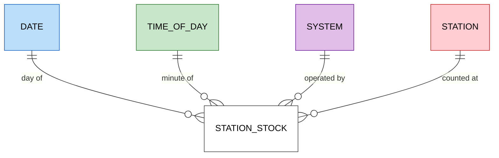
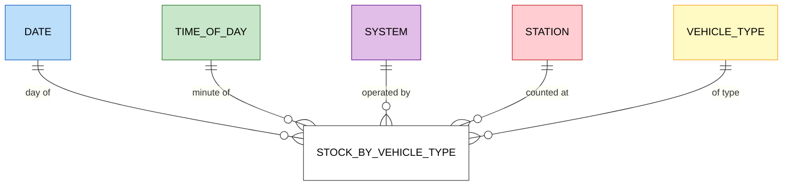
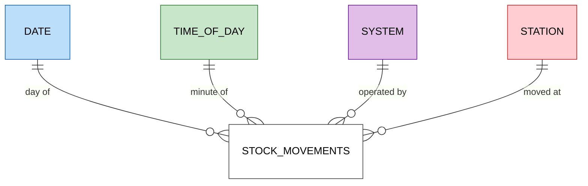

# Data model

The dimensional model of silver and gold, which answers the guiding questions of [d002](designs/d002-requirements.md#guiding-questions) for AMBici and Bicing. It is designed whole and built one business process at a time, following Kimball's bus architecture ([d005 › D1](designs/d005-data-model.md#d1-one-model-over-one-bus-matrix), [d007 › D1](designs/d007-pipeline-design.md#d1-build-by-vertical-slice)).

## Method

The model follows Kimball's four steps of dimensional design, each derived from the one before:

1. **Business process:** the event in the world that is measured.
2. **Grain:** what exactly one row of a fact represents.
3. **Dimensions:** what describes a row at that grain: when, where, what.
4. **Facts:** the measures of the row.

## Business processes

The data fits Kimball's inventory case. Stations are stores and available bikes are stock; each capture of a station's status is a periodic stock count, and trips are stock movements derived from two consecutive counts. Bike IDs rotate after each trip, so no process follows a single bike.

Each question is answered by these processes:

| Question | What it needs | Process |
|---|---|---|
| Q1 Bikes and free docks per station, now, by type | The latest count of each station | Station stock; stock by vehicle type for the split |
| Q2 Feeds on time and complete | The minutes with a capture and the age of its data; records that break invariants; frozen stations | Station stock |
| Q3 When a station is full or empty, and for how long | Occupancy in each count; runs of consecutive counts with no bikes or no docks | Station stock |
| Q4 Trips per day | Each drop in bikes between two consecutive counts is a departure, a lower bound on trips | Stock movements |
| Q5 Share of the fleet in use | Fleet minus bikes at stations minus disabled bikes, at the latest count | Station stock |
| Q6 Stations used most and least | Changes per station and day | Stock movements |
| Q7 Sources and sinks by time band | Arrivals minus departures per time band | Stock movements |
| Q8 Changes to the station network | A station's name, capacity and location over time | None: the history of the station dimension |

Movements can be derived from the stock, but they are a fact of their own because they add up differently. Stock is semi-additive: bikes counted in successive minutes are not summed over time. Movements are additive: the departures of each minute sum to the departures of the day. This pairing of a periodic snapshot and its movements is how Kimball models inventory.

## Grain

| Process | Grain | Sources |
|---|---|---|
| Station stock | One row per station and capture | `station_status`; before real-time capture, Bicing's status archive from December 2025 to 13 October 2026 ([d005 › D3](designs/d005-data-model.md#d3-feeds-that-enter-the-model)) |
| Stock by vehicle type | One row per station, capture and vehicle type | `vehicle_types_available` in `station_status` |
| Stock movements | One row per station and pair of consecutive captures with a change | Station stock, real-time captures only |

The stock is a periodic snapshot: every capture is a row, even when the station has not changed. Rows are only appended, a gap in capture shows as missing rows, and the archive's 5-minute snapshots fit the same grain. Repeated values compress well in columnar storage, so unchanged rows cost little space. The alternative, one row per station state with `valid_from` and `valid_to`, stores fewer rows but rewrites the open row on every change and cannot tell an unchanged state from a gap in capture ([d005 › D4](designs/d005-data-model.md#d4-business-processes-and-the-grain-of-the-stock)).

## Dimensions

A dimension answers what describes a fact row: when, where, whose and what. Asking those questions of the station stock's grain, one row per station and capture, gives:

| Question to the row | Answer | Dimension |
|---|---|---|
| When? | The instant of the capture | Date and time of day, apart, since questions group by day (Q4, Q6) and by hour or time band (Q3, Q7). The exact UTC instant stays in the fact |
| Where? | The station | Station: name, capacity, location, post code, municipality |
| Whose? | AMBici or Bicing | System, since every question compares the two |
| In what state? | `is_installed`, `is_renting`, `is_returning` | None: flags of the row itself, kept in the fact |

Stock by vehicle type adds *what*: the vehicle type. Stock movements share the stock's dimensions.

Four choices follow from the questions:

- **System is a dimension of its own,** not an attribute of the station: every question compares the two, and a capture's completeness and lateness (Q2) belong to the system's response, not to a station. It is conformed: every fact shares it.
- **Station keeps its history** as a slowly changing dimension of type 2: a change of name, capacity or location adds a new version with its validity period. Q8 asks for that history.
- **Post code and municipality are flattened into the station,** the usual dimensional form for a small hierarchy, rather than tables of their own linked to it (a snowflake).
- **Vehicle types compare by propulsion.** Type IDs are local to each system, while propulsion, mechanical or electric, is shared by both.

### Bus matrix

| Process | Date | Time of day | System | Station | Vehicle type |
|---|---|---|---|---|---|
| Station stock | ✓ | ✓ | ✓ | ✓ | |
| Stock by vehicle type | ✓ | ✓ | ✓ | ✓ | ✓ |
| Stock movements | ✓ | ✓ | ✓ | ✓ | |

### Star schemas

One star per process; the bus matrix above shows the dimensions they share. Facts are white, and each dimension keeps its colour in every star.

#### Station stock

#### Stock by vehicle type

#### Stock movements

Columns of each table are fixed by the slice that builds it ([d007 › D1](designs/d007-pipeline-design.md#d1-build-by-vertical-slice)).

## Data contract

The quality rules of silver and gold: the uniqueness of each grain, nullability, accepted values, referential integrity with the conformed dimensions, and invariants across columns or tables ([d005 › D29](designs/d005-data-model.md#d29-data-contract-of-the-model)). Each rule cites the decision it applies, and the test that checks it cites the rule's ID. IDs are flat and never reused, and a rule keeps its ID when it moves. A column rule carries a pending marker for T060 until the slice that creates its table's worksheet moves it there.

### Station stock

- **RDM1** The station stock shall hold one row per station and capture ([d005 › D4](designs/d005-data-model.md#d4-business-processes-and-the-grain-of-the-stock)).
- **RDM2** When a capture is stored, the station stock shall add a row for every station the capture lists, whether or not the station changed ([d005 › D4](designs/d005-data-model.md#d4-business-processes-and-the-grain-of-the-stock)).
- **RDM3** The station stock shall never update or delete a row once written ([d005 › D4](designs/d005-data-model.md#d4-business-processes-and-the-grain-of-the-stock)).
- **RDM4** The station stock shall take Bicing's rows from 2025-12-01 to 2026-10-13 from the status archive, and every other row from real-time capture ([d005 › D3](designs/d005-data-model.md#d3-feeds-that-enter-the-model)).
- **RDM5** Each row of the station stock shall record whether it comes from the archive or from real-time capture ([d005 › D3](designs/d005-data-model.md#d3-feeds-that-enter-the-model)). TODO(T060): move to the station stock's worksheet.
- **RDM6** If the archive holds more than one row for a station and snapshot, then the station stock shall keep the one with the latest `last_updated`, and on a tie the first in the archive ([d005 › D31](designs/d005-data-model.md#d31-duplicate-rows-in-the-archive)).
- **RDM7** The station stock shall name each measure taken from a GBFS field as GBFS 3.0 names it, with AMBici's `num_bikes_available` as `num_vehicles_available` ([d005 › D14](designs/d005-data-model.md#d14-vocabulary-of-the-measures)). TODO(T060): move to the station stock's worksheet.
- **RDM8** The station stock shall keep `is_installed`, `is_renting` and `is_returning` as each source publishes them ([d005 › D7](designs/d005-data-model.md#d7-station-status-flags)). TODO(T060): move to the station stock's worksheet.
- **RDM9** The station stock shall keep `last_reported` as each source publishes it ([d005 › D19](designs/d005-data-model.md#d19-last-reported-time-in-the-stock)). TODO(T060): move to the station stock's worksheet.
- **RDM10** The station stock shall keep Bicing's `num_vehicles_disabled` and `num_docks_disabled` as published, and store null as AMBici's ([d005 › D15](designs/d005-data-model.md#d15-disabled-vehicles-and-docks)). TODO(T060): move to the station stock's worksheet.
- **RDM11** While a Bicing station is out of service, with `is_renting` and `is_returning` false, the station stock shall store null as its `num_vehicles_available` ([d005 › D16](designs/d005-data-model.md#d16-vehicles-at-an-out-of-service-station)).
- **RDM12** While a station is out of service, the station stock shall keep its other counts, and AMBici's `num_vehicles_available`, as the source publishes them ([d005 › D16](designs/d005-data-model.md#d16-vehicles-at-an-out-of-service-station)).
- **RDM13** The station stock shall store no occupancy, only its two terms, `num_vehicles_available` and `num_docks_available` ([d005 › D17](designs/d005-data-model.md#d17-occupancy)).
- **RDM14** When occupancy is computed over one or more counts, the model shall divide the sum of `num_vehicles_available` by the sum of `num_vehicles_available` and `num_docks_available`, over the counts whose `num_vehicles_available` is not null ([d005 › D17](designs/d005-data-model.md#d17-occupancy)).

### Stock by vehicle type

- **RDM15** The stock by vehicle type shall hold one row per station, capture and vehicle type ([d005 › D4](designs/d005-data-model.md#d4-business-processes-and-the-grain-of-the-stock)).
- **RDM16** The stock by vehicle type shall take its rows from real-time capture only, never from the archive ([d005 › D3](designs/d005-data-model.md#d3-feeds-that-enter-the-model), [D4](designs/d005-data-model.md#d4-business-processes-and-the-grain-of-the-stock)).
- **RDM17** In each capture, the stock by vehicle type shall hold a row for every station the capture lists and every vehicle type that its system publishes in `vehicle_types` at that capture and that some station of the system has listed in `vehicle_types_available` at or before it ([d005 › D20](designs/d005-data-model.md#d20-zero-counts-in-the-stock-by-vehicle-type)).
- **RDM18** If a station's `vehicle_types_available` omits a type that RDM17 requires, then the stock by vehicle type shall store 0 as that type's `num_vehicles_available` ([d005 › D20](designs/d005-data-model.md#d20-zero-counts-in-the-stock-by-vehicle-type)).
- **RDM19** The stock by vehicle type shall store the `count` of each entry of `vehicle_types_available` as `num_vehicles_available` ([d005 › D14](designs/d005-data-model.md#d14-vocabulary-of-the-measures), [D20](designs/d005-data-model.md#d20-zero-counts-in-the-stock-by-vehicle-type)). TODO(T060): move to the stock by vehicle type's worksheet.
- **RDM20** While a Bicing station is out of service, the stock by vehicle type shall keep the station's rows and store null as their `num_vehicles_available`, in place of the values of RDM18 and RDM19 ([d005 › D16](designs/d005-data-model.md#d16-vehicles-at-an-out-of-service-station)).
- **RDM21** The stock by vehicle type shall keep each type's count as published, even when a station's types do not add up to its `num_vehicles_available` in the station stock ([d005 › D21](designs/d005-data-model.md#d21-per-type-counts-that-do-not-add-up-to-the-stations)).
