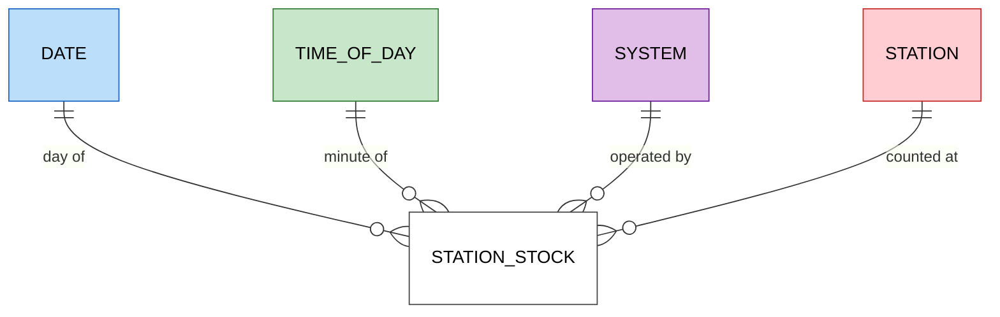
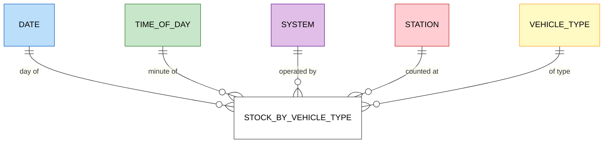
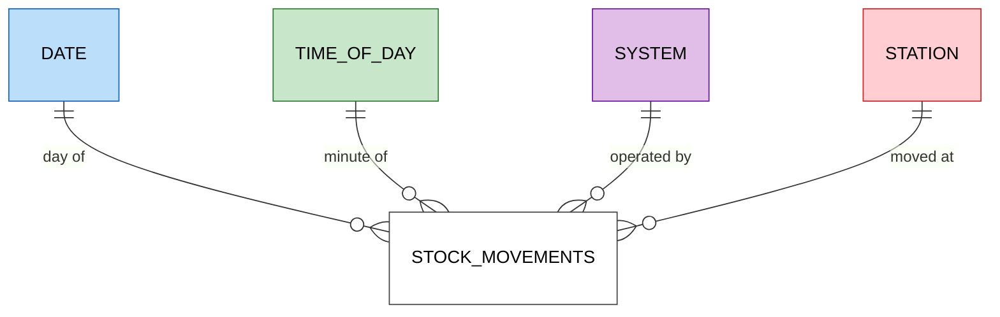
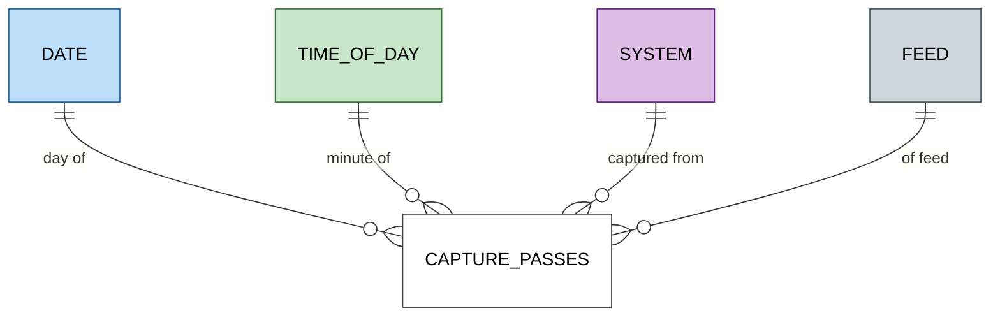

# Data model

The dimensional model of silver and gold, which answers the guiding questions of [d002](designs/d002-requirements.md#guiding-questions) for AMBici and Bicing. It is designed whole and built one business process at a time, following Kimball's bus architecture ([d005 › D1](designs/d005-processing-pipeline.md#d1-vertical-slices-over-one-bus-matrix)).

## Method

The model follows Kimball's four steps of dimensional design, each derived from the one before:

1. **Business process:** the event in the world that is measured.
2. **Grain:** what exactly one row of a fact represents.
3. **Dimensions:** what describes a row at that grain: when, where, what.
4. **Facts:** the measures of the row.

## Business processes

The data fits Kimball's inventory case. Stations are stores and available bikes are stock; each capture of a station's status is a periodic stock count, and trips are stock movements derived from two consecutive counts. Bike IDs rotate after each trip, so no process follows a single bike.

Each question is answered by these processes:

| Question | What it needs | Process |
|---|---|---|
| Q1 Bikes and free docks per station, now, by type | The latest count of each station | Station stock; stock by vehicle type for the split |
| Q2 Feeds on time and complete | Whether each pass captured each feed and how late; records that break invariants; frozen stations | Capture passes; station stock for invariants and frozen stations |
| Q3 When a station is full or empty, and for how long | Occupancy in each count; runs of consecutive counts with no bikes or no docks | Station stock |
| Q4 Trips per day | Each drop in bikes between two consecutive counts is a departure, a lower bound on trips | Stock movements |
| Q5 Share of the fleet in use | Fleet minus bikes at stations minus disabled bikes, at the latest count | Station stock |
| Q6 Stations used most and least | Changes per station and day | Stock movements |
| Q7 Sources and sinks by time band | Arrivals minus departures per time band | Stock movements |
| Q8 Changes to the station network | A station's name, capacity and location over time | None: the history of the station dimension |

Movements can be derived from the stock, but they are a fact of their own because they add up differently. Stock is semi-additive: bikes counted in successive minutes are not summed over time. Movements are additive: the departures of each minute sum to the departures of the day. This pairing of a periodic snapshot and its movements is how Kimball models inventory.

## Grain

| Process | Grain | Sources |
|---|---|---|
| Station stock | One row per station and capture | `station_status`; Bicing's historical archive |
| Stock by vehicle type | One row per station, capture and vehicle type | `vehicle_types_available` in `station_status`; the archive has no per-type counts |
| Stock movements | One row per station and pair of consecutive captures with a change | Station stock |
| Capture passes | One row per source, feed and capture pass | Capture's logs |

The stock is a periodic snapshot: every capture is a row, even when the station has not changed. Rows are only appended, a gap in capture shows as missing rows, and the archive's 5-minute snapshots fit the same grain. Repeated values compress well in columnar storage, so unchanged rows cost little space. The alternative, one row per station state with `valid_from` and `valid_to`, stores fewer rows but rewrites the open row on every change and cannot tell an unchanged state from a gap in capture ([d005 › D4](designs/d005-processing-pipeline.md#d4-business-processes-and-the-grain-of-the-stock)).

## Dimensions

A dimension answers what describes a fact row: when, where, whose and what. Asking those questions of the station stock's grain, one row per station and capture, gives:

| Question to the row | Answer | Dimension |
|---|---|---|
| When? | The instant of the capture | Date and time of day, apart, since questions group by day (Q4, Q6) and by hour or time band (Q3, Q7). The exact UTC instant stays in the fact |
| Where? | The station | Station: name, capacity, location, post code, municipality |
| Whose? | AMBici or Bicing | System, since every question compares the two |
| In what state? | `is_installed`, `is_renting`, `is_returning` | None: flags of the row itself, kept in the fact |

Stock by vehicle type adds *what*: the vehicle type. Stock movements share the stock's dimensions. Capture passes add *which feed* and have no station.

Four choices follow from the questions:

- **System is a dimension of its own,** not an attribute of the station: capture passes have no station, and Q2 compares systems as Q1 does. It is conformed: every fact shares it.
- **Station keeps its history** as a slowly changing dimension of type 2: a change of name, capacity or location adds a new version with its validity period. Q8 asks for that history, and occupancy in the past needs the capacity of its time.
- **Post code and municipality are flattened into the station,** the usual dimensional form for a small hierarchy, rather than tables of their own linked to it (a snowflake).
- **Vehicle types compare by propulsion.** Type IDs are local to each system, while propulsion, mechanical or electric, is shared by both and is the only split of the Bicing archive.

### Bus matrix

| Process | Date | Time of day | System | Station | Vehicle type | Feed |
|---|---|---|---|---|---|---|
| Station stock | ✓ | ✓ | ✓ | ✓ | | |
| Stock by vehicle type | ✓ | ✓ | ✓ | ✓ | ✓ | |
| Stock movements | ✓ | ✓ | ✓ | ✓ | | |
| Capture passes | ✓ | ✓ | ✓ | | | ✓ |

### Star schemas

One star per process; the bus matrix above shows the dimensions they share. Facts are white, and each dimension keeps its colour in every star.

#### Station stock

#### Stock by vehicle type

#### Stock movements

#### Capture passes

Columns of each table are fixed by the slice that builds it ([d005 › D1](designs/d005-processing-pipeline.md#d1-vertical-slices-over-one-bus-matrix)).
