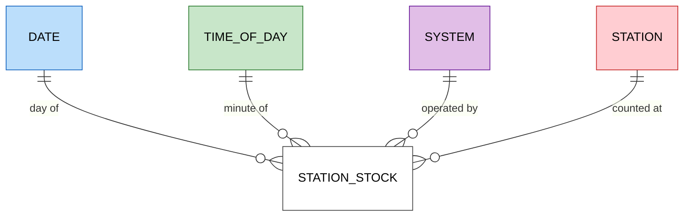
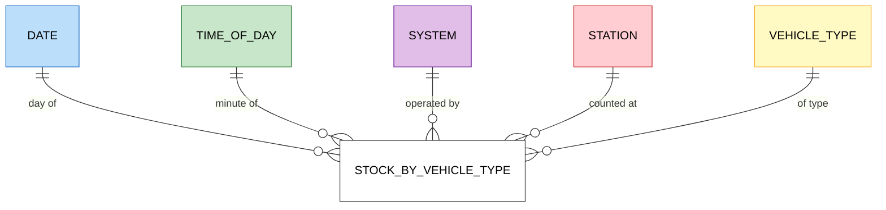
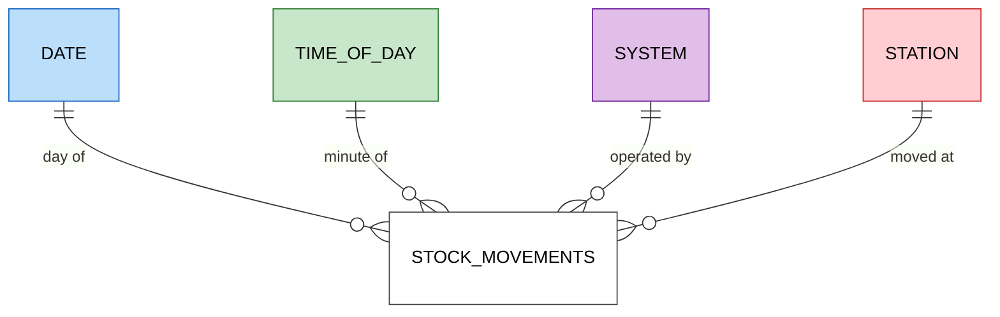

# Data model

The dimensional model of silver and gold, which answers the guiding questions of [d002](designs/d002-requirements.md#guiding-questions) for AMBici and Bicing. It is designed whole and built one business process at a time, following Kimball's bus architecture ([d005 › D1](designs/d005-data-model.md#d1-one-model-over-one-bus-matrix), [d007 › D1](designs/d007-pipeline-design.md#d1-build-by-vertical-slice)).

## Method

The model follows Kimball's four steps of dimensional design, each derived from the one before:

1. **Business process:** the event in the world that is measured.
2. **Grain:** what exactly one row of a fact represents.
3. **Dimensions:** what describes a row at that grain: when, where, what.
4. **Facts:** the measures of the row.

## Business processes

The data fits Kimball's inventory case. Stations are stores and available bikes are stock; each capture of a station's status is a periodic stock count, and trips are stock movements derived from two consecutive counts. Bike IDs rotate after each trip, so no process follows a single bike.

Each question is answered by these processes:

| Question | What it needs | Process |
|---|---|---|
| Q1 Bikes and free docks per station, now, by type | The latest count of each station | Station stock; stock by vehicle type for the split |
| Q2 Feeds on time and complete | The minutes with a capture and the age of its data; records that break invariants; frozen stations | Station stock |
| Q3 When a station is full or empty, and for how long | Occupancy in each count; runs of consecutive counts with no bikes or no docks | Station stock |
| Q4 Trips per day | Each drop in bikes between two consecutive counts is a departure, a lower bound on trips | Stock movements |
| Q5 Share of the fleet in use | Fleet minus bikes at stations minus disabled bikes, at the latest count | Station stock |
| Q6 Stations used most and least | Changes per station and day | Stock movements |
| Q7 Sources and sinks by time band | Arrivals minus departures per time band | Stock movements |
| Q8 Changes to the station network | A station's name, capacity and location over time | None: the history of the station dimension |

Movements can be derived from the stock, but they are a fact of their own because they add up differently. Stock is semi-additive: bikes counted in successive minutes are not summed over time. Movements are additive: the departures of each minute sum to the departures of the day. This pairing of a periodic snapshot and its movements is how Kimball models inventory.

## Grain

| Process | Grain | Sources |
|---|---|---|
| Station stock | One row per station and capture | `station_status`; before real-time capture, Bicing's status archive from December 2025 up to the first local day that real-time capture covers whole ([d005 › D3](designs/d005-data-model.md#d3-feeds-that-enter-the-model)) |
| Stock by vehicle type | One row per station, capture and vehicle type | `vehicle_types_available` in `station_status` |
| Stock movements | One row per station and pair of consecutive captures with a change | Station stock, real-time captures only |

The stock is a periodic snapshot: every capture is a row, even when the station has not changed. Rows are only appended, a gap in capture shows as missing rows, and the archive's 5-minute snapshots fit the same grain. Repeated values compress well in columnar storage, so unchanged rows cost little space. The alternative, one row per station state with `valid_from` and `valid_to`, stores fewer rows but rewrites the open row on every change and cannot tell an unchanged state from a gap in capture ([d005 › D4](designs/d005-data-model.md#d4-business-processes-and-the-grain-of-the-stock)).

## Dimensions

A dimension answers what describes a fact row: when, where, whose and what. Asking those questions of the station stock's grain, one row per station and capture, gives:

| Question to the row | Answer | Dimension |
|---|---|---|
| When? | The instant of the capture | Date and time of day, apart, since questions group by day (Q4, Q6) and by hour or time band (Q3, Q7). The exact UTC instant stays in the fact |
| Where? | The station | Station: name, capacity, location, post code, municipality |
| Whose? | AMBici or Bicing | System, since every question compares the two |
| In what state? | `is_installed`, `is_renting`, `is_returning` | None: flags of the row itself, kept in the fact |

Stock by vehicle type adds *what*: the vehicle type. Stock movements share the stock's dimensions.

Four choices follow from the questions:

- **System is a dimension of its own,** not an attribute of the station: every question compares the two, and a capture's completeness and lateness (Q2) belong to the system's response, not to a station. It is conformed: every fact shares it.
- **Station keeps its history** as a slowly changing dimension of type 2: a change in any of its attributes adds a new version with its validity period, so each count reads the station as it was at its capture. Q8 asks for the history of its name, capacity and location.
- **Post code and municipality are flattened into the station,** the usual dimensional form for a small hierarchy, rather than tables of their own linked to it (a snowflake).
- **Vehicle types compare by propulsion.** Type IDs are local to each system, while propulsion, mechanical or electric, is shared by both.

### Bus matrix

| Process | Date | Time of day | System | Station | Vehicle type |
|---|---|---|---|---|---|
| Station stock | ✓ | ✓ | ✓ | ✓ | |
| Stock by vehicle type | ✓ | ✓ | ✓ | ✓ | ✓ |
| Stock movements | ✓ | ✓ | ✓ | ✓ | |

### Star schemas

One star per process; the bus matrix above shows the dimensions they share. Facts are white, and each dimension keeps its colour in every star.

#### Station stock

#### Stock by vehicle type

#### Stock movements

Columns of each table are fixed by the slice that builds it ([d007 › D1](designs/d007-pipeline-design.md#d1-build-by-vertical-slice)).

## Data contract

The rules of silver and gold that the model's design sets, in two classes: transformation specs (`TR`), how each table and value is built, verified by tests in CI; and documentation items (`RDM`), what the model's documents hold, verified by inspection ([d005 › D29](designs/d005-data-model.md#d29-data-contract-of-the-model)). The rules checked on real data in every run and the quality indicators live in the quality catalog, [data-quality.md](data-quality.md); each column's type, nullability and accepted values are its schema, in its table's worksheet ([d007 › #1, #4](designs/d007-pipeline-design.md#22-decision-summary)). Each rule cites the decision it applies, and the test that checks it cites the rule's ID. IDs are flat, with a prefix per class, and never reused; a rule keeps its ID when it moves. Each rule states one behaviour, so it is either a table rule or a column rule; a rule split in two keeps its ID in its table part, and its column part takes the next free ID of its class. A column rule carries a pending marker for T060 until the slice that creates its table's worksheet moves it there: a transformation to the column's Rule, a rule on nullability or accepted values to the column's schema ([d007 › #6](designs/d007-pipeline-design.md#22-decision-summary)).

### Station stock

- **TR1** When a capture is stored, the station stock shall add a row for every station the capture lists, whether or not the station changed ([d005 › D4](designs/d005-data-model.md#d4-business-processes-and-the-grain-of-the-stock)).
- **TR2** The station stock shall take Bicing's rows before the cutover from the status archive, from its December 2025 month on, and every other row from real-time capture; the cutover is the start of the first local day (`Europe/Madrid`) that begins after Bicing's first real-time `station_status` capture in bronze ([d005 › D3](designs/d005-data-model.md#d3-feeds-that-enter-the-model)).
- **TR3** Each row of the station stock shall record whether it comes from the archive or from real-time capture ([d005 › D3](designs/d005-data-model.md#d3-feeds-that-enter-the-model)). TODO(T060): move to the station stock's worksheet.
- **TR4** If the archive holds more than one row for a station and snapshot, then the station stock shall keep the one with the latest `last_updated`, and on a tie the first in the archive ([d005 › D31](designs/d005-data-model.md#d31-duplicate-rows-in-the-archive)).
- **TR5** The station stock shall name each measure taken from a GBFS field as GBFS 3.0 names it, with AMBici's `num_bikes_available` as `num_vehicles_available` ([d005 › D14](designs/d005-data-model.md#d14-vocabulary-of-the-measures)). TODO(T060): move to the station stock's worksheet.
- **TR6** The station stock shall keep `is_installed`, `is_renting` and `is_returning` as each source publishes them ([d005 › D7](designs/d005-data-model.md#d7-station-status-flags)). TODO(T060): move to the station stock's worksheet.
- **TR7** The station stock shall keep `last_reported` as each source publishes it ([d005 › D19](designs/d005-data-model.md#d19-last-reported-time-in-the-stock)). TODO(T060): move to the station stock's worksheet.
- **TR8** The station stock shall keep Bicing's `num_vehicles_disabled` and `num_docks_disabled` as published, and store null as AMBici's ([d005 › D15](designs/d005-data-model.md#d15-disabled-vehicles-and-docks)). TODO(T060): move to the station stock's worksheet.
- **TR9** While a Bicing station is out of service, with `is_renting` and `is_returning` false, the station stock shall store null as its `num_vehicles_available` ([d005 › D16](designs/d005-data-model.md#d16-vehicles-at-an-out-of-service-station)).
- **TR10** The station stock shall keep `num_vehicles_available` and `num_docks_available` as each source publishes them, in service or not, except where TR9 stores null ([d005 › D16](designs/d005-data-model.md#d16-vehicles-at-an-out-of-service-station)). TODO(T060): move to the station stock's worksheet.
- **TR11** The station stock shall store no occupancy, only its two terms, `num_vehicles_available` and `num_docks_available` ([d005 › D17](designs/d005-data-model.md#d17-occupancy)).
- **TR12** When occupancy is computed over one or more counts, the model shall divide the sum of `num_vehicles_available` by the sum of `num_vehicles_available` and `num_docks_available`, over the counts whose `num_vehicles_available` is not null ([d005 › D17](designs/d005-data-model.md#d17-occupancy)).
- **TR13** If none of the counts that occupancy is computed over has a `num_vehicles_available`, then the model shall give null as the occupancy ([d005 › D16](designs/d005-data-model.md#d16-vehicles-at-an-out-of-service-station), [D17](designs/d005-data-model.md#d17-occupancy)).

### Stock by vehicle type

- **TR14** The stock by vehicle type shall take its rows from real-time capture only, never from the archive ([d005 › D3](designs/d005-data-model.md#d3-feeds-that-enter-the-model), [D4](designs/d005-data-model.md#d4-business-processes-and-the-grain-of-the-stock)).
- **TR15** In each capture, the stock by vehicle type shall hold a row for every station the capture lists and every vehicle type that its system publishes in the latest `vehicle_types` response captured at or before that capture and that some station of the system has listed in `vehicle_types_available` at or before it ([d005 › D20](designs/d005-data-model.md#d20-zero-counts-in-the-stock-by-vehicle-type)).
- **TR16** If a station's `vehicle_types_available` omits a type that TR15 requires, then the stock by vehicle type shall store 0 as that type's `num_vehicles_available` ([d005 › D20](designs/d005-data-model.md#d20-zero-counts-in-the-stock-by-vehicle-type)). TODO(T060): move to the stock by vehicle type's worksheet.
- **TR17** In each row that TR15 requires, the stock by vehicle type shall store the `count` of the type's entry in the station's `vehicle_types_available` as `num_vehicles_available` ([d005 › D14](designs/d005-data-model.md#d14-vocabulary-of-the-measures), [D20](designs/d005-data-model.md#d20-zero-counts-in-the-stock-by-vehicle-type)). TODO(T060): move to the stock by vehicle type's worksheet.
- **TR18** While a Bicing station is out of service, the stock by vehicle type shall keep the station's rows and store null as their `num_vehicles_available`, in place of the values of TR16 and TR17 ([d005 › D16](designs/d005-data-model.md#d16-vehicles-at-an-out-of-service-station)).
- **TR19** The stock by vehicle type shall keep each type's count as published, even when a station's types do not add up to its `num_vehicles_available` in the station stock ([d005 › D21](designs/d005-data-model.md#d21-per-type-counts-that-do-not-add-up-to-the-stations)).

### Stock movements

- **TR20** The stock movements shall pair only the station stock's real-time counts, never its archive rows ([d005 › D3](designs/d005-data-model.md#d3-feeds-that-enter-the-model), [D23](designs/d005-data-model.md#d23-movements-across-gaps-in-capture)).
- **TR21** The stock movements shall take two real-time counts of a station as consecutive when no other real-time count of the station lies between them, however far apart they are ([d005 › D23](designs/d005-data-model.md#d23-movements-across-gaps-in-capture)).
- **TR22** The stock movements shall take the vehicles at a station as `num_vehicles_available` plus `num_vehicles_disabled` in Bicing, and `num_vehicles_available` in AMBici ([d005 › D22](designs/d005-data-model.md#d22-departures-and-arrivals)).
- **TR23** When the vehicles at a station drop between two consecutive counts with `is_renting` true in both, the stock movements shall store the drop as `departures` ([d005 › D22](designs/d005-data-model.md#d22-departures-and-arrivals), [D24](designs/d005-data-model.md#d24-movements-at-an-out-of-service-station)).
- **TR24** When the vehicles at a station rise between two consecutive counts with `is_returning` true in both, the stock movements shall store the rise as `arrivals` ([d005 › D22](designs/d005-data-model.md#d22-departures-and-arrivals), [D24](designs/d005-data-model.md#d24-movements-at-an-out-of-service-station)).
- **TR25** If the vehicles drop while `is_renting` is false in either count, or rise while `is_returning` is false in either count, then the stock movements shall add no row for that pair ([d005 › D24](designs/d005-data-model.md#d24-movements-at-an-out-of-service-station)).
- **TR26** Each row of the stock movements shall keep the capture time of both of its counts ([d005 › D23](designs/d005-data-model.md#d23-movements-across-gaps-in-capture)). TODO(T060): move to the stock movements' worksheet.
- **TR27** Each row of the stock movements shall fall on the date and time of day of its later count ([d005 › D23](designs/d005-data-model.md#d23-movements-across-gaps-in-capture)).

### Dimensions

- **TR28** When any attribute of a station changes, the station dimension shall add a new version of the station with its validity period, keeping the earlier one (SCD type 2) ([d005 › D5](designs/d005-data-model.md#d5-conformed-dimensions)).
- **TR29** The station dimension shall hold post code, municipality, district and neighbourhood as attributes of the station, with no table of their own ([d005 › D5](designs/d005-data-model.md#d5-conformed-dimensions), [D10](designs/d005-data-model.md#d10-barcelona-district-and-neighbourhood)).
- **TR30** If a station in the archive's stock is absent from real-time `station_information`, then the station dimension shall hold one inferred member for its `station_id`, never completed afterwards ([d005 › D30](designs/d005-data-model.md#d30-archive-stations-with-no-attributes)).
- **TR31** An inferred member of the station dimension shall take Barcelona as its municipality and false as +P, `Unknown` as every other text attribute, and null as every other attribute ([d005 › D30](designs/d005-data-model.md#d30-archive-stations-with-no-attributes)). TODO(T060): move to the station dimension's worksheet.
- **TR32** The station dimension shall keep a station's name as published, trimmed of leading and trailing spaces, taking the `ca` entry of Bicing's localised `name` ([d005 › D12](designs/d005-data-model.md#d12-station-names)). TODO(T060): move to the station dimension's worksheet.
- **TR33** The station dimension shall take AMBici's post code from ICGC's reverse geocoder, as the post code of the address nearest to the station ([d005 › D6](designs/d005-data-model.md#d6-ambicis-post-code)). TODO(T060): move to the station dimension's worksheet.
- **TR34** The station dimension shall left-pad Bicing's `post_code` with zeros to 5 digits, and take a missing one from ICGC as in TR33 ([d005 › D6](designs/d005-data-model.md#d6-ambicis-post-code)). TODO(T060): move to the station dimension's worksheet.
- **TR35** The station dimension shall take a station's municipality from AMBici's region, matched to ICGC's name without its leading article, except the region "AMB"; as Barcelona for every Bicing station; and otherwise as the ICGC municipality that contains its coordinates ([d005 › D9](designs/d005-data-model.md#d9-station-municipality)). TODO(T060): move to the station dimension's worksheet.
- **TR36** The station dimension shall take each municipality's code and name from ICGC's boundaries, as `CODIMUNI` and `NOMMUNI` ([d005 › D9](designs/d005-data-model.md#d9-station-municipality)). TODO(T060): move to the station dimension's worksheet.
- **TR37** The station dimension shall keep, besides each station's municipality, the ICGC municipality that contains its coordinates ([d005 › D9](designs/d005-data-model.md#d9-station-municipality)). TODO(T060): move to the station dimension's worksheet.
- **TR38** The station dimension shall give every station in Barcelona, except an inferred member (TR30), the neighbourhood whose City Council boundary contains its coordinates, and the district that neighbourhood belongs to ([d005 › D10](designs/d005-data-model.md#d10-barcelona-district-and-neighbourhood), [D30](designs/d005-data-model.md#d30-archive-stations-with-no-attributes)). TODO(T060): move to the station dimension's worksheet.
- **TR39** The station dimension shall keep Bicing's `cross_street` as published, split into district and neighbourhood codes ([d005 › D10](designs/d005-data-model.md#d10-barcelona-district-and-neighbourhood)). TODO(T060): move to the station dimension's worksheet.
- **TR40** Each row of the review table shall hold the values its check compared ([d005 › D5](designs/d005-data-model.md#d5-conformed-dimensions)). TODO(T060): move to the review table's worksheet.
- **TR41** The station dimension shall store `Not applicable` as district and neighbourhood of a station outside Barcelona ([d005 › D10](designs/d005-data-model.md#d10-barcelona-district-and-neighbourhood), [D13](designs/d005-data-model.md#d13-model-labels)). TODO(T060): move to the station dimension's worksheet.
- **TR42** The station dimension shall name municipalities, districts and neighbourhoods in their official form, as ICGC and the City Council publish it, with a leading article in lower case ([d005 › D11](designs/d005-data-model.md#d11-place-names)). TODO(T060): move to the station dimension's worksheet.
- **TR43** The station dimension shall keep a sorting form of each place name, with the leading article moved to the end: ICGC's `NOMMUNIIND` for municipalities, and the same rule for districts and neighbourhoods ([d005 › D11](designs/d005-data-model.md#d11-place-names)). TODO(T060): move to the station dimension's worksheet.
- **TR44** The station dimension shall mark +P as true for a station in the +P list and false for every other, never null ([d005 › D18](designs/d005-data-model.md#d18-ambicis-p-stations)). TODO(T060): move to the station dimension's worksheet.
- **TR45** The +P list shall hold one row per +P station, sorted by `station_id` ([d005 › D18](designs/d005-data-model.md#d18-ambicis-p-stations)).
- **TR46** The +P list shall hold each station's name from `station_information`, and no check date ([d005 › D18](designs/d005-data-model.md#d18-ambicis-p-stations)). TODO(T060): move to the +P list's worksheet.
- **TR47** The vehicle type dimension shall hold one row per vehicle type each system publishes ([d005 › D8](designs/d005-data-model.md#d8-vehicle-propulsion)).
- **TR48** The vehicle type dimension shall keep each type's `vehicle_type_id`, name and `form_factor` as published ([d005 › D8](designs/d005-data-model.md#d8-vehicle-propulsion)). TODO(T060): move to the vehicle type dimension's worksheet.
- **TR49** The vehicle type dimension shall derive propulsion from `propulsion_type`: `human` as `Mechanical`, `electric_assist` as `Electric` ([d005 › D8](designs/d005-data-model.md#d8-vehicle-propulsion)). TODO(T060): move to the vehicle type dimension's worksheet.
- **TR50** The model shall define its own values only from the closed domain `Mechanical`, `Electric` and `Not applicable`, besides the inferred members' `Unknown` ([d005 › D13](designs/d005-data-model.md#d13-model-labels), [D30](designs/d005-data-model.md#d30-archive-stations-with-no-attributes)). TODO(T060): move to the accepted values of the columns it covers, in their worksheets.
- **TR51** Every fact row shall keep its UTC instant and reference the date and time-of-day dimensions by the local date and minute of that instant in `Europe/Madrid` ([d005 › D33](designs/d005-data-model.md#d33-local-calendar-keys)).

### Drill-across, service and timeliness

- **RDM1** The station stock and the stock movements shall share the date, time-of-day, system and station dimensions, so that a query combines them by drill-across, with no column added to either for lack of service or frozen counts ([d005 › D25](designs/d005-data-model.md#d25-lack-of-service-and-frozen-counts)).
- **TR52** The model shall measure a station's service from the station stock, as the share of its counts with `is_renting` true and the share with `is_returning` true ([d005 › D25](designs/d005-data-model.md#d25-lack-of-service-and-frozen-counts)).
- **TR53** Each row of the station stock shall keep the `last_updated` of the response it comes from ([d005 › D26](designs/d005-data-model.md#d26-timeliness-and-completeness-of-the-feeds)). TODO(T060): move to the station stock's worksheet.

### Model as a whole

- **RDM2** Of the operators' feeds and archives, the model shall read only those that enter it: `station_status`, `station_information` and `vehicle_types` of both systems, AMBici's `system_regions`, and Bicing's status archive ([d005 › D3](designs/d005-data-model.md#d3-feeds-that-enter-the-model)).
- **RDM3** Each table of silver and gold shall have a worksheet that names the business process or conformed dimension of the bus matrix it belongs to, or the one it serves as reference data or as the review table ([d005 › D1](designs/d005-data-model.md#d1-one-model-over-one-bus-matrix), [D5](designs/d005-data-model.md#d5-conformed-dimensions), [D18](designs/d005-data-model.md#d18-ambicis-p-stations), [D28](designs/d005-data-model.md#d28-source-field-dictionary-and-detailed-design-per-table)).
- **RDM4** Each gold table's worksheet shall name the guiding question the table answers and the business process it reads, the one that [Business processes](#business-processes) maps to that question ([d005 › D27](designs/d005-data-model.md#d27-gold-per-question), [D28](designs/d005-data-model.md#d28-source-field-dictionary-and-detailed-design-per-table)).
- **RDM5** Each column of silver and gold shall have a row in its table's worksheet, with its description, type, nullability, accepted values, source field in AMBici and in Bicing, and transformation spec, citing the decision it applies, and, for a measure of a fact, its additivity ([d005 › D28](designs/d005-data-model.md#d28-source-field-dictionary-and-detailed-design-per-table), [d007 › #4](designs/d007-pipeline-design.md#22-decision-summary)).
- **RDM6** Each source field the model reads shall have an entry in the Fields of its feed in the source card, with a link to its definition in the GBFS version the source publishes and the values observed ([d005 › D28](designs/d005-data-model.md#d28-source-field-dictionary-and-detailed-design-per-table)).
