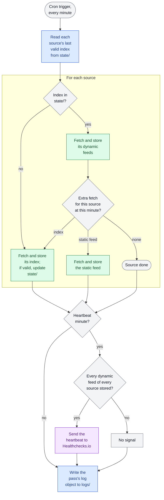

<!--
Design doc template. A design doc is the working document of one task: Spec (what and why), Plan (how), Steps (implementation), Close (what was delivered).
It is detailed enough that Code can implement it without making design decisions.
Sections marked Optional are kept only when they apply.
-->

# Design: Bronze data capture

- **Task:** T039
- **ADRs:** [ADR-0005](../decisions/0005-utc-for-all-stored-timestamps.md), [ADR-0006](../decisions/0006-raw-layer-keeps-source-responses-untouched.md), [ADR-0011](../decisions/0011-cloudflare-workers-r2-for-realtime-capture.md), [ADR-0012](../decisions/0012-collectors-decoupled-by-output-contract.md), [ADR-0018](../decisions/0018-medallion-architecture.md), [ADR-0020](../decisions/0020-bronze-as-captured-objects.md), [ADR-0021](../decisions/0021-retention-per-layer.md), [ADR-0023](../decisions/0023-storage-security-baseline.md), [ADR-0031](../decisions/0031-heartbeat-alerts-for-the-pipeline.md)
- **New ADRs from this doc:** [ADR-0035](../decisions/0035-cloud-resource-naming.md) (D1); [ADR-0036](../decisions/0036-log-convention-across-components.md) (D9), which supersedes [ADR-0030](../decisions/archive/0030-pipeline-logs.md); [ADR-0037](../decisions/0037-test-fixtures-per-component.md) (DL15), which supersedes [ADR-0009](../decisions/archive/0009-trimmed-source-samples-as-test-fixtures.md)

## Status

<!-- State: Draft 📝 · Ready for implementation 🎬 · In progress 🔄 · Complete ✅.
Phase: the blocks and reviews completed.
Current step: the step being implemented, or —. -->

- State: Draft 📝
- Phase: [x] Spec · [x] Plan · [ ] Plan review · [ ] Steps · [ ] Steps review
- Current step: —
- Next: Plan review in progress. Fixed: the switch cutoff per feed (DL18); s012 in File layout. Pending the owner's decision: no method for the CPU check of passes with an extra fetch; no tool for the 7-day completeness check; `Content-Encoding` of the simulated sources undecided; minor: heartbeat timeout, token names (ADR-0035), size limit on non-gzip bodies, the fixture-binding rule in `cloudflare-worker.md`.

## 1. Spec — what and why

<!-- What the result does seen from outside, not how it is built. The test: if whoever uses the result would notice a change, it belongs here; if not, it belongs to the Plan. External systems and their data (feeds, fields) may be named. -->

### 1.1 Context

<!-- 2–4 sentences for a reader with no prior context: the problem or need and why it matters now; who or what uses the result; where things stand today, including any design or spike this builds on. No solution here: it starts in Decided at framing. For a correction: current vs expected behaviour and how to reproduce it. -->

The data pipeline needs a continuous, trustworthy record of the AMBici and Bicing feeds in the bronze layer. Today that record comes from the interim Worker `capture-v4`, left running by [s006](../spikes/s006-cloudflare-capture.md), which writes to the spike's bucket `bikesharing-capture-spike`. That deployment was built to answer the spike's questions, not for production: [s006 › Inputs for the production design](../spikes/s006-cloudflare-capture.md#inputs-for-the-production-design) lists its known gaps, and it captures every static feed in the same pass once per hour. Those passes reached 23–28 ms of CPU in the spike's window, against the 10 ms limit; the average per run has since stayed at or below 5 ms. This task replaces that Worker and that bucket with production capture.

### 1.2 Decided at framing

<!-- Optional. One heading per decision about what the result does. In this order, so the reader finds what matters first:
1. The decision and why, in one short paragraph.
2. What would change it, and what would not, each with the action to take. Only when a later event could reopen it.
3. The options rejected.
4. The artefact that fixes it, in whatever form the decision needs (e.g. a mapping table, a page map, a weighted matrix). An artefact that does not fit here or must outlive the design goes in its own file: the Plan decides where it lives and its format, File layout lists it, and this decision links to it.

A security decision lists its threats in this table, with IDs `TH1`, `TH2`… per document:

| # | Threat (STRIDE) | Impact | Control | Requirement |
|---|---|---|---|---|
| `TH1` | | | | |
-->

#### D1. Bronze bucket and key convention

Bronze lives in `bikesharing-bronze`, and the key layout of [ADR-0012](../decisions/0012-collectors-decoupled-by-output-contract.md) stays as it is. The first prefix names the kind of content, not the layer: the bucket already names the layer, and the bucket lock applies per prefix, so content with different lock rules needs its own prefix ([ADR-0023](../decisions/0023-storage-security-baseline.md)). A new source, such as a weather feed, goes under `raw/<source>/` and is covered by the existing lock rule.

The project-wide convention is that buckets are named `bikesharing-<content>`, and a layer prefix is used only when a bucket holds more than one layer. The lakehouse bucket is therefore `bikesharing-lakehouse`, with `silver/` and `gold/`. Static assets are not stored in a bucket, since they are published by redeploying ([ADR-0033](../decisions/0033-data-published-by-redeploying-static-assets.md)).

Rejected: sources at the bucket root (`<source>/…`). It shows the sources one level higher, but mixes them with the operational prefixes and needs one lock rule per source.

```text
bikesharing-bronze/
├── raw/<source>/<feed>/<YYYY-MM-DD>/<YYYYMMDDTHHMMSSZ>.json.gz   locked
├── logs/                                                         locked
└── state/                                                        not locked
```

#### D2. Spike data moved to production

`V4/raw/` is copied to `bikesharing-bronze` under `raw/`, without the `V4/` prefix, before the bucket lock is enabled. Bronze cannot be rebuilt and these responses cannot be captured again; they already meet the output contract ([ADR-0012](../decisions/0012-collectors-decoupled-by-output-contract.md)). `V4/logs/` and `V4/state/` are not copied: the log structure will change, and `state/` is rebuilt by capture. Copied objects therefore have no capture logs in production.

The spike logs are queried once before they are deleted, because they have only been analysed within the [s006](../spikes/s006-cloudflare-capture.md) window and can reveal unknown events.

Rejected: starting production with an empty bucket. It loses the captured responses that exist only in the spike's bucket.

#### D3. Feed cadence

This table lists every feed capture takes. The dynamic feeds are captured every minute, the cadence of the spike's capture. Each static feed is captured at the cadence its observed changes justify, because a change that is not captured cannot be recovered. Over 12.5 days of hourly captures (2026-10-14 to 2026-10-26), comparing the `data` field, `station_information` changed 68 times in Bicing and 4 times in AMBici; two other feeds changed once and the remaining ten never did. The GBFS `ttl` does not help: nearly every feed declares 60 s or 0 regardless of how often it changes.

| Cadence | Feeds |
|---|---|
| Every minute (dynamic) | `station_status` of each source, `free_bike_status` of AMBici |
| Hourly | `station_information` of each source; the index (`gbfs`) of each source, at its refresh (D5) |
| Daily | The other 12 static feeds: `system_information`, `system_pricing_plans`, `system_regions`, `vehicle_types` and `geofencing_zones` of each source, `system_hours` of AMBici, `gbfs_versions` of Bicing |

A change in a daily feed is recorded up to 24 h late, and two changes in one day keep only the last one.

If a daily feed starts changing more than once a day as a habit, move it to hourly. A daily feed that changes occasionally does not reopen this decision.

Rejected: every 2 days or weekly for the daily feeds. Weekly saves about 1.2 MB per year against bronze's roughly 2.9 GB per month, and delays a change by up to 7 days. **DL4**

#### D4. Static feeds spread across passes

Each capture pass carries the dynamic feeds and at most one extra fetch, either a static feed, an index refresh (D5) or the heartbeat (D10), so dynamic feeds are captured every minute and no extra fetch adds to another's CPU time. [s006](../spikes/s006-cloudflare-capture.md) measured about 5 ms for a dynamic pass and 23–28 ms with the 16 feeds of a static pass, which estimates 1.5 ms per added feed and about 6.5 ms for a pass with one extra fetch. Extra fetches run at fixed, distinct minutes; 132 of the 1,440 daily passes carry one. While a source has no valid index, its passes fetch only that index, in place of its feeds and extras (D8), so they cost less than a normal pass.

CPU time can shift without any change of ours. During the spike's capture, median source latency moved from about 270 ms to 38 ms on 2026-10-29 at 22:07 UTC, and to about 145 ms on 2026-11-03 at about 08:00 UTC, while the average CPU per run rose from 2–3 ms to almost 5 ms; the only deployment was on 2026-10-14. Both shifts coincided with a change in the second at which the cron starts, which suggests a move of the Worker by Cloudflare; this is not confirmed. Passes with a static feed therefore keep a margin below the limit.

If passes with an extra fetch exceed the 10 ms limit in production, run them in their own executions.

Rejected: separate executions for static feeds from the start. They give the lowest peak, but add complexity and depend on Cloudflare starting two independent executions in the same minute, which is unverified.

#### D5. Hourly index refresh

Each source's index (`gbfs` feed) is refreshed once per hour, independently of the static feeds, at a different minute for each source. If a feed's URL changes, capture picks it up within an hour, which bounds the dynamic data lost. The size of both indexes did not change in 22 days of hourly reads, so the refresh rarely finds anything new, but its cost is small: 48 fetches and up to 96 writes per day.

Each index response is stored under `raw/` like any feed, whether the index is valid or not, so its history, including a rejected index, can be rebuilt; only a valid index replaces the last one kept for capture (D8).

Rejected:

- Daily refresh: a changed URL could cost up to 24 h of dynamic data, which cannot be captured again.
- Daily refresh, and also on a feed's 404: it loses the least data, but adds logic that a brief 404 would trigger needlessly. **DL4**

#### D6. Capture completeness target

Each dynamic feed has a clean capture in at least 99.5% of the minutes of each calendar month, which allows 216 minutes of failures in a 30-day month. A minute is clean for a feed when an object of that feed is stored under `raw/` for that minute (D9). The first 7 days of production are checked against the same threshold; the monthly follow-up belongs to the data quality task (D7). Over 21 full days of the spike's capture (2026-10-15 to 2026-11-04), each feed reached 99.81–99.82%, or about 78 minutes per month, and fell below 99.5% on a single day. The target follows the SRE practice of an indicator with an objective and an error budget. Static feeds have no percentage, because one failure in a daily feed is a whole day without data; a failure there is handled as an individual event.

A missed month leads to reviewing its cause, with no automatic action. If capture stays well above the target for several months, raise the target.

Rejected:

- 99.9%: its 43-minute budget is below the failures already observed.
- 99%: its 432-minute budget could hide a real degradation.

#### D7. Quality questions answered from the pipeline

The pipeline answers quality questions, including completeness (D6), and capture only provides the data to answer them, because a derived figure can be rebuilt from the logs and calculating it in capture would add CPU. Capture's logs must allow an efficient answer, in Worker CPU, R2 storage and operations, and pipeline compute on Modal. Building the calculation and its storage belongs to the data quality task.

#### D8. Capture failure behaviour

Capture retries only what cannot be recovered in another way, using bounded retries, and records every failure. A failed fetch leaves no data yet, and the next scheduled capture brings a newer response; a failed write loses a response already fetched. Over 22 days of the spike's logs there were 57 source failures and 10 writes lost to R2 internal errors, out of 103,664 log lines.

| Event | Behaviour |
|---|---|
| A source takes longer than 60 s | The fetch is abandoned and logged as a failure. This keeps a hung request from losing the whole pass, and it would have dropped 11 valid responses in 22 days. |
| A source fails | No retry in the pass. The failure is logged and the next scheduled capture applies, so a change in a daily feed can be recorded up to 48 h late. |
| A data write fails | Up to 2 retries with a short wait. A key that already exists counts as written, not as a failure. |
| A log write fails | Up to 2 retries with a short wait. If it still fails, the error goes to the Workers logs. |
| An index refresh fails or returns an invalid index | Capture keeps the last valid index and logs the error. An index is valid when every entry has `name` and `url`, and it includes every feed listed in D3. |
| A source has no valid index yet, as on the first pass | Capture refreshes that source's index on every pass and fetches none of its feeds until the index is valid, an exception to D4. |

Each key is written once. Duplicate passes start at different seconds, so their keys differ; both objects are kept and the pipeline deduplicates them ([d002 › R13](d002-requirements.md#requirements)). In the unobserved case of two passes in the same second, the existing-key rule applies. `latency_ms` is recorded whenever the source responds, and is null only when no response arrives.

Rejected:

- Timeouts of 30 s (drops 35 valid responses with no CPU saving, since waiting uses no CPU) and no timeout (a hung request can lose the pass).
- Retrying source failures in the pass: it lengthens passes for little gain, since a source that is down usually stays down during the retries.
- Retrying failed static feeds in later passes: it adds state and logic for about 5 lost days per year across the daily feeds, which rarely change.
- Ignoring only the invalid index entry: the feed would stop being captured even with a known URL. Merging valid entries per feed would avoid that, but only helps when two index problems coincide, which was not observed.

#### D9. Capture logs

Capture writes one log object per pass as JSON Lines, under `logs/date=<YYYY-MM-DD>/<run_id>.jsonl`, where `run_id` is the pass's capture time in the [ADR-0012](../decisions/0012-collectors-decoupled-by-output-contract.md) key format. The format follows [ADR-0036](../decisions/0036-log-convention-across-components.md), one log convention for every component, which supersedes [ADR-0030](../decisions/archive/0030-pipeline-logs.md) to add two common fields: `component` names the part of the system that wrote the event, following the practice of `service.name` in OpenTelemetry, and `version` identifies the deployed code of that component. Every event therefore carries `ts`, `level`, `component`, `version`, `run_id` and `event`, plus the fields of its event.

In capture, `component` is `capture` and `version` is the Worker's version ID.

| Event | Level | Own fields |
|---|---|---|
| `feed_captured` | `info` | `source`, `feed`, `status`, `latency_ms`, `bytes`, `attempts`, `recompressed` |
| `feed_failed` | `error` | `source`, `feed`, `status`, `latency_ms`, `attempts`, `error_type`, `error` |
| `index_refreshed` | `info` | `source`, `status`, `latency_ms`, `bytes`, `attempts`, `recompressed`, `unknown_feeds` |
| `index_rejected` | `error` | `source`, `status`, `latency_ms`, `attempts`, `error_type`, `error` |
| `heartbeat_sent` | `info` | `status`, `latency_ms` |
| `heartbeat_failed` | `warning` | `status`, `latency_ms`, `error_type`, `error` |

`attempts` counts write attempts, and is 0 when the source fails. `error_type` is one of `http`, `timeout`, `network`, `too_large`, `write` or `invalid_index`; the event tells whether it came from a feed, an index or the heartbeat. `level` is `info`, `warning` for a failure that does not affect the data, such as the heartbeat's, or `error`. `unknown_feeds` lists the feeds in the index that are not listed in D3, and is usually empty; a feed that the source removes makes the index invalid (D8). `recompressed` is true when the response did not arrive as gzip and capture compressed it before storing; capture relies on an undocumented option to keep the source's gzip ([s006](../spikes/s006-cloudflare-capture.md), F9), so this flags a change in the source or the runtime.

These fields answer the following capture questions, the starting point for T042:

- Is the completeness target (D6) met, and which minutes are missing?
- Is a source degrading, or is a response size unusual?
- Are there duplicate or late passes, and does each object match a log line?
- Did a failure come from the source, a timeout or R2, and is R2 failing even when retries succeed?
- Which deployed code produced this data?
- Has a source added or removed a feed?
- Do responses still arrive as gzip, or is capture compressing them?

The objects under `raw/` are the record of what was captured, and the logs explain failures: a log write can fail after its data was stored (D8).

Questions that need the response's content, such as whether a source keeps returning HTTP 200 with frozen data, belong to the pipeline.

One object per pass meets D7's criteria. It costs about 30–35 MB per month and 43,200 writes (4.3% of R2's free Class A quota), and it adds no CPU beyond the write already measured. The pipeline reads only new objects once and consolidates them in the data quality table (T042); the originals stay under the bucket lock. Pipeline compute is unmeasured, so T042 validates it.

Rejected:

- Daily compaction in capture: reading 1,440 objects does not fit the 10 ms CPU limit.
- Logging failures only: it loses the latency and sizes of clean captures, which revealed the latency shifts and set the timeout in D8.
- Showing the origin only through a prefix in the event name (`capture.feed_captured`): it needs no ADR change, but mixes two meanings in one field and depends on a naming convention. **DL4** **DL7** **DL14**

#### D10. Capture heartbeat

Capture signals a heartbeat to Healthchecks.io once per hour, the service [ADR-0031](../decisions/0031-heartbeat-alerts-for-the-pipeline.md) chose for the pipeline, which emails the owner when no signal arrives within the period plus 1 h of grace. The monitor sits outside Cloudflare, because a stopped Worker cannot report its own stop. The pass sends the signal only if it stored all three dynamic feeds listed in D3, so the signal means that data is being stored, not just that the Worker ran: an outage of R2 or of a source that lasts for hours also raises the alert. The goal is that capture never stays down for days unnoticed, which an alert within about 2 h meets, rather than a fast reaction. A failed signal does not affect capture, and is logged as `heartbeat_failed` (D9) without the signal URL (D12).

One failed signal does not alert, since the next one arrives within the grace. An outage shorter than about an hour may raise no alert, and shows in completeness (D6) instead. The signal costs nothing on Cloudflare's Free plan: it is an outgoing request from an existing pass.

What this alert does not cover: a static feed or an index failing repeatedly, and a source returning HTTP 200 with frozen data, both quality checks in T042; and CPU peaks, which the Worker cannot measure.

Rejected:

- Every minute or every 5 minutes: faster alerts than the owner can act on, at a higher CPU cost.
- Twice a day: the same cost as hourly, with alerts up to about 24 h late.
- A signal on every run, whatever it stored: it would miss a Worker that runs but stores nothing.

#### D11. Switch from spike capture to production

Production capture replaces `capture-v4` by running in parallel with it, so the switch leaves no gap in data that cannot be captured again. The overlap also tests production against the spike's capture, minute by minute. It doubles the requests to the sources for its duration, at one per feed and minute, which is accepted since no volume limit has been observed.

1. The production Worker is deployed and captures to `bikesharing-bronze` while `capture-v4` keeps capturing.
2. Once production has stored every feed at least once, `V4/raw/` is copied, for each source and feed, up to the last pass before that feed's first object in production (D2), so the copy leaves no gap, adds no duplicates and no key can collide.
3. The copy is checked by object count per day and feed. If the counts differ, the copy is repeated: the lock is never enabled on an unchecked copy.
4. The bucket lock is enabled.
5. `capture-v4` is stopped, and the queries of D2 run on its complete logs.
6. `bikesharing-capture-spike` is emptied and deleted, together with `capture-v4` and its token, so no access to unused data remains (least privilege, as in [ADR-0023](../decisions/0023-storage-security-baseline.md)). A spike that needs a test bucket creates and removes its own, as [s010](../spikes/s010-storage-table-format.md) did.

The lock is enabled only after the check, as [ADR-0023](../decisions/0023-storage-security-baseline.md) requires, because under the lock a wrong copy can no longer be corrected; production's first hours stay unprotected until then.

Rejected:

- Stopping `capture-v4` before deploying production: it is simpler, but leaves a gap that grows if the deployment fails.
- Keeping the spike's bucket as a test bucket: its name breaks the convention of D1, and it keeps an old token alive. **DL18**

#### D12. Capture security

One STRIDE pass over D1–D11 keeps the threats with a real chance or a lasting impact; the storage-wide baseline of [ADR-0023](../decisions/0023-storage-security-baseline.md) still applies. Bronze's lock makes some impacts permanent, so their controls act before the write. The response size limit leaves room for legitimate growth, such as a source publishing real geofencing zones, since the largest response observed is 57 KB.

| # | Threat (STRIDE) | Impact | Control | Requirement |
|---|---|---|---|---|
| `TH1` | Spoofing: an HTTP request triggers capture passes | Extra writes, CPU and duplicate data, kept forever under the lock | No HTTP handler in the production Worker; its public URL stays disabled | R21 |
| `TH2` | Denial of service: an oversized response | Storage kept forever under the lock, and its cost | Responses over 10 MB are rejected and logged | R22 |
| `TH3` | Information disclosure: the heartbeat URL ends up in a log | The secret cannot be deleted from a locked log | Errors of the heartbeat signal never include its URL | R23 |
| `TH4` | Tampering: the bucket lock is misconfigured | Bronze can be deleted or overwritten | After enabling it, overwriting an existing object is checked to fail | Done when |
| `TH5` | Spoofing: the heartbeat URL leaks | False signals hide an outage | Accepted, as in [ADR-0031](../decisions/0031-heartbeat-alerts-for-the-pipeline.md); it gives access to nothing else | Accepted |
| `TH6` | Elevation of privilege: the deployment token leaks | Code that writes junk or alters `state/` is deployed | A deployment token scoped to this Worker only, held by the owner | Done when |

### 1.3 Requirements

<!-- Optional. The acceptance criteria, cited by number in the Test plan and the steps. They translate Decided at framing and cite the decision they come from; nothing is decided here.
One behaviour per requirement, verifiable, with a measurable threshold where one applies. Written in EARS:
- Ubiquitous: The <system> shall <response>.
- Event: When <trigger>, the <system> shall <response>.
- State: While <state>, the <system> shall <response>.
- Unwanted: If <condition>, then the <system> shall <response>.
- Optional: Where <feature is included>, the <system> shall <response>.
Only requirements specific to this task; project-wide rules (CLAUDE.md, ADRs) are not repeated. -->

- **R1** The capture shall store the response of each dynamic feed listed in D3 every minute in `bikesharing-bronze`, under the key layout of D1, except as R13 allows. (D1, D3, D4)
- **R2** The capture shall capture `station_information` of each source once per hour. (D3)
- **R3** The capture shall capture each of the 12 daily static feeds once per day. (D3)
- **R4** The capture shall make at most one extra fetch per pass (a static feed, an index refresh or the heartbeat), at fixed and distinct minutes, except as R13 allows. (D4, D5, D10)
- **R5** The capture shall refresh each source's index once per hour, at a different minute for each source, except as R13 allows. (D5)
- **R6** The capture shall fetch each feed from the URL in its source's last valid index. (D5)
- **R7** If a source takes longer than 60 s to return its complete response, then the capture shall abandon the fetch and log it as a failure. (D8)
- **R8** If a source fails, then the capture shall log the failure without retrying in the same pass. (D8)
- **R9** If a data or log write fails, then the capture shall retry it up to 2 times with a short wait. (D8)
- **R10** If a write finds its key already stored, then the capture shall count it as written. (D8)
- **R11** If a log write still fails after its retries, then the capture shall write the error to the Workers logs. (D8)
- **R12** If an index refresh fails or returns an invalid index, because an entry lacks `name` or `url` or a feed listed in D3 is missing, then the capture shall keep the source's last valid index and log the rejection. (D8)
- **R13** While a source has no valid index, the capture shall refresh that source's index on every pass and fetch none of its feeds. (D4, D8)
- **R14** The capture shall record `latency_ms` whenever the source responds, and leave it null only when no response arrives. (D8)
- **R15** The capture shall write one log object per pass under `logs/date=<YYYY-MM-DD>/<run_id>.jsonl`, whose events carry `ts`, `level`, `component`, `version`, `run_id` and `event`. (D9)
- **R16** The capture shall log the events and fields listed in D9, including `unknown_feeds`. (D7, D9)
- **R17** When the heartbeat pass has stored all three dynamic feeds listed in D3, the capture shall send the heartbeat signal. (D10)
- **R18** If the heartbeat pass has not stored all three dynamic feeds listed in D3, then the capture shall not send the heartbeat signal. (D10)
- **R19** If no signal arrives within 1 h plus 1 h of grace, then the monitor shall email the owner. (D10)
- **R20** If the heartbeat signal fails, then the capture shall continue unaffected and log the failure. (D9, D10)
- **R21** The production Worker shall run only from its cron trigger, with no HTTP handler, and its public URL shall stay disabled. (D12, TH1)
- **R22** If a response exceeds 10 MB, then the capture shall reject it and log the failure. (D12, TH2)
- **R23** The capture shall not include the heartbeat URL in any log or error. (D12, TH3)
- **R24** When an index refresh receives a successful response, the capture shall store it under `raw/<source>/gbfs/`, whether or not the index is valid. (D3, D5)

### 1.4 Done when

<!-- Optional. Only what closes this task and Requirements cannot express: operational actions, checks on real data, understanding. The general closing rule is checked in `.claude/skills/implement/review.md`. -->

- `V4/raw/` is copied up to the cutoff of each feed and checked by object count before the bucket lock is enabled. (D2, D11)
- The bucket lock is enabled, and overwriting an existing object fails. (D11, TH4)
- The queries of D2 have run on the spike's complete logs. (D2)
- `bikesharing-capture-spike`, `capture-v4` and its token are deleted. (D11)
- The probe's test bucket `bikesharing-t039-write-once` is deleted. ([ADR-0035](../decisions/0035-cloud-resource-naming.md))
- The deployment token is scoped to the production Worker only. (TH6)
- Passes with an extra fetch stay below 10 ms of CPU in the first days of production. (D4)
- Each dynamic feed has a clean capture in at least 99.5% of the minutes of the first 7 days of production. (D6)

### 1.5 Out of scope

<!-- Optional. What someone could expect and will not be done, each item pointing to the task that covers it. -->

- Calculating and storing completeness and other quality answers (D7), from the questions and fields in D9 — T042
- Quality checks capture does not make: repeated failures of a static feed or an index, and HTTP 200 with frozen data (D10) — T042
- Fixture entries chosen for variety of records (empty, full or out-of-service stations), which only code that reads them can use ([Fixtures](#fixtures)) — T040
- Citing the finding IDs of other documents with their source, such as s008's in `docs/testing-strategy.md` — T058
- Whether the pipeline gets a component folder of its own, like `capture/`, instead of `src/` and `tests/` at the root — T040
- Centralising quality rules and targets, such as D6's, in one place — T042

## 2. Plan — how

<!-- 2-3 sentences -->

### 2.1 Approach

<!-- Detailed plan organized by #### blocks.
Block `3. Steps` is written using this plan.
If some block contains `options considered`, include them with pros and cons.
-->

#### Component layout

Production capture is one Worker for both sources, since every pass carries the dynamic feeds of both and the heartbeat depends on all of them (D4, D10). It lives in `capture/`, named after its `component` in the logs (D9), and is written in JavaScript. The code follows *functional core, imperative shell*: the schedule, the source table, index validation and event building are pure functions; fetching, writing and signalling are a thin layer around them.

Sources are configuration: each entry in `sources.js` names its `kind`, and `adapters/<kind>.js` knows how that kind finds its feed URLs and validates its index (Adapter pattern). A new GBFS source adds one entry; a source that is not GBFS also adds an adapter. The heartbeat requires every dynamic feed in `sources.js`, not a fixed count.

Only `storage.js` accesses the bucket; `index-state.js` and `log.js` go through it. Only `worker.js` and `wrangler.jsonc` depend on the Workers runtime's entry point and trigger.

```text
capture/
├── .nvmrc                Pinned Node version
├── package.json          Dependencies and scripts
├── package-lock.json
├── wrangler.jsonc        Cron trigger, R2 binding, public URL disabled
├── vitest.config.js
├── scripts/
│   └── trim-fixtures.js  Fetches and trims the fixtures (Fixtures)
├── src/
│   ├── worker.js         Entry point: the `scheduled` handler only (R21)
│   ├── sources.js        Source table: id, kind, index URL and feeds by cadence (D3)
│   ├── adapters/
│   │   └── gbfs.js       Reads a GBFS index and validates it (D5, D8)
│   ├── schedule.js       Which extra fetch, if any, runs at each minute (D4, D5, D10)
│   ├── pass.js           One pass: dynamic feeds plus at most one extra fetch
│   ├── fetch.js          Source request with the 60 s timeout and 10 MB limit (D8, D12)
│   ├── index-state.js    Reads and stores each source's last valid index under `state/`
│   ├── storage.js        Object keys, write-once and retries; the only module that accesses the bucket (D1, D8)
│   ├── log.js            Pass events and the log object (D9)
│   └── heartbeat.js      Healthchecks.io signal (D10)
└── test/
    ├── unit/             <module>.test.js
    ├── integration/      The `scheduled` handler in workerd with in-memory R2
    ├── contract/         Producer side of the vectors in `contracts/`
    └── fixtures/         `<source>/<feed>.json` and `manifest.json` (ADR-0037)
```

Options considered:

- **One flat `capture/` folder, sources as configuration (chosen).** One code path for both sources; adding a source is mostly data.
- **`collector/` with one subfolder per source and a shared core.** Matches the earlier rule's guess, but adds structure to separate sources that share all their logic.

#### Pass schedule

`schedule.js` holds the calendar as an explicit table, keyed by the event's `scheduledTime` in UTC, not by the clock, so a late pass still makes its extra fetch. Each source's index refresh comes 5 minutes before its `station_information`, which then uses the refreshed URLs; minute `:00` carries no extra fetch.

| Minute of every hour | Extra fetch |
|---|---|
| `:07` | Bicing index |
| `:12` | Bicing `station_information` |
| `:22` | Heartbeat |
| `:37` | AMBici index |
| `:42` | AMBici `station_information` |

The 12 daily feeds run at minute `:52` of every even hour, alternating sources, so an outage of one hour costs at most one of them:

| Time (UTC) | Source | Feed |
|---|---|---|
| 00:52 | Bicing | `system_information` |
| 02:52 | AMBici | `system_information` |
| 04:52 | Bicing | `system_pricing_plans` |
| 06:52 | AMBici | `system_pricing_plans` |
| 08:52 | Bicing | `system_regions` |
| 10:52 | AMBici | `system_regions` |
| 12:52 | Bicing | `vehicle_types` |
| 14:52 | AMBici | `vehicle_types` |
| 16:52 | Bicing | `geofencing_zones` |
| 18:52 | AMBici | `geofencing_zones` |
| 20:52 | Bicing | `gbfs_versions` |
| 22:52 | AMBici | `system_hours` |

This gives 5 × 24 + 12 = 132 extra fetches per day (D4).

Options considered for the daily feeds:

- **One every 2 hours (chosen).** Source failures tend to cluster; an outage of one hour loses at most one daily feed.
- **All within one hour.** Equally readable, but an outage in that hour loses the day's daily feeds of the affected source.

#### Index state

Every pass reads each source's last valid index from `state/index/<source>.json`; the Worker keeps nothing in memory between passes (stateless processes, 12-factor). The object holds the validated form, independent of the adapter:

```json
{ "refreshed_at": "2026-11-06T10:07:00Z", "feeds": { "station_status": "https://…" } }
```

A refresh that returns a valid index overwrites it; a missing or unreadable object means the source has no valid index (D8). A valid index is adopted only once its response is stored under `raw/`: if that write or the write to `state/` fails after its retries, the refresh is logged as `index_rejected` with `error_type: write`, and the last valid index stays in use. So `index_refreshed` means stored, valid and in use, and the index in use is always in bronze. **DL13** This costs 2 reads per pass, about 86,400 per month, or 0.9% of R2's free Class B quota.

If R2 reads approach the free Class B quota, for example as sources are added, evaluate the in-memory cache below.

Options considered:

- **Read `state/` on every pass (chosen).** Always consistent with the last refresh, with no cache to test.
- **Memory first, `state/` as fallback, as in `capture-v4`.** Saves reads when the isolate is reused, but an isolate that misses the refresh minute keeps a stale index unless the cache also expires.

#### Write-once

`storage.js` writes every object under `raw/` and `logs/` as a conditional put, `onlyIf` with `If-None-Match: *` (RFC 9110 conditional requests): R2 writes only if the key holds nothing, as one atomic operation. A key that already holds an object counts as written (R10), and R2 signals it in two ways:

- **Without the bucket lock:** the put returns `null`.
- **Under the bucket lock:** the put throws, with the code only in the message (`The object is locked by the bucket policy. (10069)`).

So when a conditional put throws, `storage.js` checks the key with `head`: if an object is there, the write counts as done and is not retried; if not, or if `head` also fails, the attempt counts as failed and is retried (R9). This depends on no error code or message, and also covers a write that R2 stored but whose answer was lost. The `head` runs only on that error path. **DL17** Objects under `state/` are overwritten with a plain put.

The write-once probe ran on 2026-11-06 in the test bucket `bikesharing-t039-write-once`, with a lock rule on `locked/`, through the R2 binding in `wrangler dev` with the bucket connected remotely, and against Miniflare's in-memory R2, which the integration tests use (`spikes/cloudflare-capture-spike/js/src/probe-write-once.js`). Every object kept its first body. **DL9**

| Case | R2, no lock | R2, under the lock | Miniflare |
|---|---|---|---|
| Conditional put, new key | Writes | Writes | Writes |
| Conditional put, existing key (`Headers` or `etagDoesNotMatch: "*"`) | `null` | Throws `10069` | `null` |
| Plain put, existing key | — | Throws `10069` | — |

Miniflare answers as R2 without the lock; it does not simulate the lock, so the error path is tested with a fake binding ([Test plan](#26-test-plan)).

Options considered:

- **Conditional put, with `head` on error (chosen).** One atomic operation, and no dependency on the lock or on error messages.
- **Conditional put, reading `10069` in the message as "exists".** No extra operation, but it depends on the text of an error message; if the text changes, stored objects are logged as failed writes.
- **Plain put, reading the lock's error as "exists".** Before the lock is enabled a retry overwrites silently, and it depends on an error message.
- **`head`, then put.** Two operations per object, with a window in which two passes can both write the key.

#### Pass logs

`log.js` collects the pass's events in memory and `pass.js` writes them as one object in a `finally` block, so a pass that fails halfway still writes its log (D9).

| Field | Source |
|---|---|
| `run_id` | The pass's actual start, truncated to the second, in the [ADR-0012](../decisions/0012-collectors-decoupled-by-output-contract.md) key format; also the timestamp of the pass's data keys, so duplicate passes get distinct keys (D8) |
| `ts` | The event's time, ISO 8601 UTC with milliseconds |
| `component` | `capture` |
| `version` | `CF_VERSION_METADATA.id`, the version metadata binding |

The schedule uses `scheduledTime` and the keys use the actual start; the two differ by the seconds the cron starts late. If the log write still fails after its retries, its lines go to Workers Logs, enabled under `observability` in `wrangler.jsonc` (R11).

#### Source fetch

`fetch.js` requests every response with `Accept-Encoding: gzip` and `encodeResponseBody: "manual"`, which keeps the source's gzip bytes undecoded ([s006](../spikes/s006-cloudflare-capture.md), F9); those bytes are stored as received, with no compression work. The fetches of a pass run in parallel, since waiting uses no CPU.

- **Timeout:** `AbortSignal.timeout()` covers the whole response, body included (R7); its expiry is `timeout`. The duration is a parameter, 60 s in production, so tests use milliseconds. **DL9**
- **Size limit:** the body is read as a stream and the fetch is aborted once it exceeds 10 MB, measured on the stored, compressed bytes (R22); this is `too_large`. Bicing sends no `content-length`, so the header cannot be trusted for this.
- **A response that is not gzip:** a body whose first two bytes are not the gzip magic number `1f 8b` (RFC 1952) is compressed with `CompressionStream` before storing, and logged with `recompressed: true` (D9). The check reads the bytes, not `Content-Encoding`, so a runtime that stopped honouring `encodeResponseBody` would cost CPU instead of storing plain JSON under a `.json.gz` key (ADR-0012) under the lock. **DL7**
- **Index:** fetched like any feed, stored under `raw/` (R24), then decompressed in memory and validated by its adapter; the decompressed size has the same 10 MB limit.
- **`latency_ms`:** from the request to the end of reading the body, success or failure, once headers have arrived; `null` when none arrive (R14).

#### Tests and contracts

Shared contract vectors live in a top-level `contracts/` folder, owned by neither component; every CI job that reads them runs on any change to `contracts/**` ([ADR-0015](../decisions/0015-contract-tests-by-contract-kind.md)).

What local tests cannot verify, and what covers it (**DL9**):

| Gap | Covered by |
|---|---|
| Whether Miniflare's R2 answers a conditional put as R2 does | The write-once probe, run against both ([Write-once](#write-once)) |
| The bucket lock, which Miniflare does not simulate | The write-once probe and the overwrite check after enabling the lock (TH4) |
| The 60 s timeout, too long for a test | The duration is a parameter ([Source fetch](#source-fetch)) |
| CPU time against the 10 ms limit, unlike Cloudflare's locally | Measured in the first days of production (Done when) |

Options considered:

- **Top-level `contracts/` (chosen).** Neutral ground for an agreement between two components.
- **Inside the producer, `capture/test/contracts/`.** Next to who defines it, but the pipeline would read inside another component's test folder.

#### Fixtures

`scripts/trim-fixtures.js` builds capture's fixtures from live responses ([ADR-0037](../decisions/0037-test-fixtures-per-component.md)). It runs on the local machine with Node, `npm run fixtures`, using only Node's built-in modules and `fetch`; it is run again when a source changes its format, and its output is committed.

- **Input:** for each source in `sources.js`, its index, then every feed the index lists for it, fetched once from the source.
- **Trimming:** the index is kept whole, since it is the only response capture parses. In every other feed, the list of entries under `data` (stations, vehicles, regions, plans, vehicle types, zones) keeps its first 3 entries, and everything else is kept as received; short lists stay whole. Capture stores feeds as opaque bytes, so which entries are kept changes no code path.
- **Output:** pretty-printed, uncompressed JSON at `test/fixtures/<source>/<feed>.json`, a name that does not change when the fixtures are regenerated. Tests compress it in memory before serving it.
- **Provenance:** `test/fixtures/manifest.json` holds one entry per fixture, with `source`, `feed`, `url` and `captured_at` (ISO 8601 UTC), plus `attribution` for Bicing (see its source card); the script rewrites it with the fixtures.

Edge cases are not fixtures: an invalid index, a body that is not gzip, an oversized body, a timeout and the absence of `content-length` are built in memory by each test from a fixture. **DL16**

Options considered:

- **Live fetch, uncompressed JSON with stable names, first entries (chosen).** Current quirks, readable diffs, and tests that survive a regeneration.
- **The spike's local capture as input.** No request to the sources, but its responses get older with every regeneration.
- **The capture date in the file name.** Visible at a glance, but each regeneration renames the files the tests load.
- **Entries chosen for variety (empty, full, out of service).** Exercises nothing in capture, which does not read them; it belongs to the pipeline's fixtures.

#### Deployment

The owner deploys the Worker `bikesharing-capture` from the local machine with `npx wrangler deploy`. `wrangler.jsonc` sets:

| Key | Value | Why |
|---|---|---|
| `name` | `bikesharing-capture` | Project naming (D1) |
| `triggers.crons` | `["* * * * *"]` | One pass per minute (D3) |
| `r2_buckets` | binding `BUCKET` → `bikesharing-bronze` | The Worker reaches R2 through the binding, with no R2 token |
| `workers_dev`, `preview_urls` | `false`, set explicitly | No public URL (R21); `workers_dev` defaults to `true` |
| `version_metadata` | binding `CF_VERSION_METADATA` | The `version` log field ([Pass logs](#pass-logs)) |
| `observability.enabled` | `true` | Workers Logs, the fallback for a failed log write (R11) |

The heartbeat URL is a Worker secret, `HEARTBEAT_URL`, set with `wrangler secret put`, and never stored in a repository file (R23).

The deployment credential is an account-owned API token scoped to Editor on this Worker only, with a one-year expiry, read by wrangler from `CLOUDFLARE_API_TOKEN` (least privilege, NIST SP 800-53 AC-6; TH6). Such a token can update a Worker but not create it, so the first deploy runs with `wrangler login`, and the owner then creates the token and runs `wrangler logout`. The first deploy with the token checks the two points Cloudflare's docs leave open: that Editor suffices for a Worker with an R2 binding, and for `workers_dev: false`; if either fails, the permission is widened only as far as needed, and recorded here.

After every deploy, the owner runs a smoke test on the first passes: each dynamic feed has a new object under `raw/` that passes `gunzip -t`, and the pass's log object exists with `recompressed: false` and the deployed version ID in `version`. It covers what local tests cannot, such as `encodeResponseBody` ([Tests and contracts](#tests-and-contracts)).

Options considered:

- **Token scoped to this Worker (chosen).** A leak reaches only this Worker, and stops at expiry; available since Cloudflare's per-Worker permissions of September 2026.
- **`wrangler login` for every deploy.** Simplest, but keeps an account-wide permission on the local machine.

#### Switch tooling

The owner runs the switch of D11 from the local machine with rclone, as in [s006](../spikes/s006-cloudflare-capture.md), and one throwaway script next to the spike's analysis, `spikes/cloudflare-capture-spike/analysis/spike_raw_switch.py` (Python standard library only), with two commands.

The cutoff is per source and feed: the minute of that feed's first object in production. It is read from an `rclone lsf -R` listing of `bikesharing-bronze/raw/` taken before the first copy, since copied objects come first afterwards, and kept in a file that both commands read, so a repeated copy uses the same cutoffs.

- `keys`: writes the cutoffs file, then lists the keys under `V4/raw/` whose timestamp is earlier than their feed's cutoff, as paths relative to `V4/raw/`. It exits non-zero if a feed under `V4/raw/` has no object in production yet.
- `count`: compares the number of objects per day and feed under `V4/raw/` and under `bikesharing-bronze/raw/`, both before each feed's cutoff, from two `rclone lsf -R` listings, and exits non-zero on any difference.

The copy is server-side, from bucket to bucket: `rclone copy --files-from <keys> r2:bikesharing-capture-spike/V4/raw r2:bikesharing-bronze/raw`, so rclone verifies checksums and retries. The queries of D2 are `spikes/cloudflare-capture-spike/analysis/spike-log-queries.sql`, run with DuckDB over the local copy of the spike's logs after a last `rclone copy` once `capture-v4` has stopped. Close records the cutoff of each feed, the counts per day and feed, and what the queries found.

rclone uses an R2 token with Object Read & Write on `bikesharing-capture-spike` and `bikesharing-bronze`, deleted with the spike's bucket (D11). **DL18**

Options considered:

- **rclone server-side copy and a small script (chosen).** A tool proven in the spike; the only new code filters and counts.
- **One Python script with `boto3`.** One piece, but its retries and verification must be written, for a one-off run.
- **rclone from the local copy to bronze.** Avoids the bucket-to-bucket copy, but uploads over 1.3 GB and trusts the local copy to be complete; the fallback if the server-side copy fails.

### 2.2 Decision log

<!-- It logs decisions about the plan, including changes. Oldest first.
Entries follow .claude/rules/docs/decision-log.md (log only, change links).
- Applies to: anchor link(s) to the section where the decision is applied, named in one or two words.
- Decided at: the Status phase where it was decided (Plan, Steps), or `<phase> review` when decided while reviewing that phase.
- R: Requirement affected.
-->

| # | Applies to | Decision | Reason | R | Decided at |
|---|---|---|---|---|---|
| DL1 | [Layout](#component-layout) | One Worker in `capture/`, sources as configuration with one adapter per kind; functional core, imperative shell | One code path for both sources, and a new source is mostly data | R1 | Plan |
| DL2 | [Schedule](#pass-schedule) | Daily feeds one every 2 hours at `:52`, alternating sources | An outage of one hour loses at most one daily feed | R3, R4 | Plan |
| DL3 | [Index state](#index-state) | Each pass reads the last valid index from `state/`, nothing kept in memory (stateless processes, 12-factor) | Always consistent, no cache to expire, about 0.9% of the free read quota | R6, R12, R13 | Plan |
| DL4 | [D3](#d3-feed-cadence), [D5](#d5-hourly-index-refresh), [D9](#d9-capture-logs) | Every index response is stored under `raw/`, valid or not; Spec change | Bronze keeps every captured response (ADR-0006, ADR-0020); +1% objects, compacted in silver | R24 | Plan |
| DL5 | [Write-once](#write-once) | Conditional put with `If-None-Match: *` under `raw/` and `logs/` (RFC 9110 conditional requests) | Atomic and independent of the lock and of error messages | R9, R10 | Plan |
| DL6 | [Write-once](#write-once) | R2's answers are probed before Plan approval, in a test bucket of their own | `storage.js` rests on verified behaviour; the spike's bucket still holds uncopied data and a running capture | R10 | Plan |
| DL7 | [D9](#d9-capture-logs), [Source fetch](#source-fetch) | Bodies that are not gzip by magic number are compressed and logged as `recompressed`; Spec change | Flags a change in the undocumented `encodeResponseBody` before it costs silent corruption | R16 | Plan |
| DL8 | [Tests](#tests-and-contracts) | Shared contract vectors in a top-level `contracts/` folder | A contract between two components belongs to neither | R1, R15 | Plan |
| DL9 | [Tests](#tests-and-contracts) | The write-once probe also runs against Miniflare's R2; the fetch timeout is a parameter | Integration tests rest on a verified simulator; the timeout is testable without waiting 60 s | R7, R10 | Plan |
| DL10 | [Deployment](#deployment) | Deploy with an account-owned token scoped to Editor on this Worker, one-year expiry; first deploy with `wrangler login` (least privilege, NIST SP 800-53 AC-6) | A leak reaches only this Worker | R21 | Plan |
| DL11 | [Switch tooling](#switch-tooling) | rclone server-side copy with a key list up to the cutoff, and a standard-library script that lists keys and compares counts **→ DL18** | Proven tool from s006; the only new code filters and counts | — | Plan |
| DL12 | [ADR-0035](../decisions/0035-cloud-resource-naming.md) | One naming pattern for every cloud resource, `bikesharing-<name>`: buckets by content, compute by component, tokens by component and purpose, temporary resources by task (resource naming conventions) | Cheap to fix while resources are few; buckets cannot be renamed | — | Plan |
| DL13 | [Index state](#index-state) | A valid index is adopted only once stored under `raw/` and `state/`; a failed write is `index_rejected` with `error_type: write` | `index_refreshed` keeps one meaning, and the index in use is always in bronze | R12, R24 | Plan |
| DL14 | [D9](#d9-capture-logs), [ADR-0036](../decisions/0036-log-convention-across-components.md) | The common fields come from a new ADR that supersedes ADR-0030, not from amending it; Spec change | Accepted ADRs are immutable (`.claude/rules/docs/adr.md`) | R15 | Plan |
| DL15 | [Layout](#component-layout), [ADR-0037](../decisions/0037-test-fixtures-per-component.md) | Fixtures in each component's tests, `capture/test/fixtures/` for capture; ADR-0037 supersedes ADR-0009 | Each component owns its test data, as it owns its code and tests (ADR-0016, ADR-0017) | — | Plan |
| DL16 | [Fixtures](#fixtures) | A Node script fetches live responses, keeps the index whole and the first 3 entries of each other feed, and writes uncompressed JSON with stable names and a provenance manifest | Current quirks and readable diffs; capture does not read feed entries, so choosing them adds nothing | — | Plan |
| DL17 | [Write-once](#write-once) | When a conditional put throws, `head` decides whether the object exists: if so it counts as written, otherwise the attempt is retried | Under the lock R2 throws instead of returning `null` (probe); `head` depends on no error message | R9, R10 | Plan |
| DL18 | [D11](#d11-switch-from-spike-capture-to-production), [Switch tooling](#switch-tooling) | The copy cutoff is per source and feed, the minute of its first object in production, read before the first copy (high-water mark per partition); Spec change **refines DL11** | No minute is lost, nothing is duplicated, and the count check compares like with like | — | Plan review |

### 2.3 Architecture

<!-- Optional. One diagram and 2–3 sentences. -->

One pass, started by the cron every minute. Each source is handled on its own, so a source without a valid index fetches only that index and does not hold back the other; the heartbeat and the log belong to the whole pass, and the log is written last, whatever happened before.



Colours show what each box touches: grey, no I/O (the functional core); blue, R2 only; green, a source fetch stored in R2; purple, Healthchecks.io. The schedule decides the extra fetch ([Pass schedule](#pass-schedule)); every object goes through the write-once put of `storage.js` ([Write-once](#write-once)), and a failure at any box is logged and does not stop the rest of the pass (D8).

### 2.4 File layout

<!-- Every file and folder the task creates or modifies, documents included, as a tree: (new) or (modified), and its purpose or change in one line. A task that adds a component also lists its CI job in `.github/workflows/ci.yml` (recipe in `.claude/rules/code/ci.md`), and its version files, manifest and lockfile (`.claude/rules/code/dependencies.md`). -->

```text
.
├── CLAUDE.md                                  (modified) Project structure: `capture/` and `contracts/`
├── .env.example                               (modified) Variables grouped and documented; deploy and R2 token scopes
├── .claude/rules/code/
│   ├── cloudflare-worker.md                   (modified) `paths:` to `capture/**`; contract tests; TODO removed
│   └── testing.md                             (modified) `contracts/**` in `paths:`; TODO removed
├── .github/workflows/ci.yml                   (modified) Job `capture` and final job `ci-passed`; TODO removed
├── capture/                                   (new) Production capture Worker, as in Component layout
│   ├── .nvmrc                                 (new) Pinned Node version
│   ├── package.json                           (new) Manifest
│   ├── package-lock.json                      (new) Lockfile
│   ├── wrangler.jsonc                         (new) Worker configuration (Deployment), with `compatibility_date`
│   ├── vitest.config.js                       (new) Test configuration, sources through `outboundService`
│   ├── scripts/trim-fixtures.js               (new) Fetches and trims the fixtures (Fixtures)
│   ├── src/                                   (new) The modules of Component layout
│   └── test/
│       ├── unit/                              (new) One file per module
│       ├── integration/                       (new) The `scheduled` handler in workerd with in-memory R2
│       ├── contract/                          (new) Producer side of the vectors in `contracts/`
│       └── fixtures/                          (new) `<source>/<feed>.json` and `manifest.json` (Fixtures)
├── contracts/                                 (new) Shared contract vectors (Tests and contracts)
│   ├── bronze-keys.json                       (new) Object keys (ADR-0012, D1)
│   └── capture-logs.json                      (new) Log lines (D9)
├── docs/
│   ├── architecture.md                        (modified) Runtime view: pass schedule and one-pass diagram; completeness target (D6)
│   ├── testing-strategy.md                    (modified) Worker section paths to `capture/`; contract tests; smoke test (Deployment)
│   ├── decisions/
│   │   ├── 0023-storage-security-baseline.md  (modified) TODOs resolved by this design removed
│   │   ├── 0035-cloud-resource-naming.md      (new) Cloud resource naming (D1)
│   │   ├── 0036-log-convention-across-components.md (new) One log convention, with `component` and `version` (D9)
│   │   ├── 0037-test-fixtures-per-component.md (new) Fixtures in each component's tests (DL15)
│   │   ├── archive/0009-trimmed-source-samples-as-test-fixtures.md (moved) Superseded by ADR-0037
│   │   └── archive/0030-pipeline-logs.md      (moved) Superseded by ADR-0036
│   ├── sources/
│   │   ├── ambici.md                          (modified) Facts observed in the spike's capture that capture depends on
│   │   └── bicing.md                          (modified) Same; `OPEN_DATA_BCN_TOKEN`
│   └── spikes/
│       └── s012-execution-target.md           (modified) `TODO(T039)` removed: its items are resolved by D9 and D10
└── spikes/cloudflare-capture-spike/
    ├── README.md                              (modified) The switch script, the log queries and the probe
    ├── analysis/
    │   ├── spike_raw_switch.py                (new) Key list up to the cutoff and count comparison (Switch tooling)
    │   └── spike-log-queries.sql              (new) The queries of D2
    └── js/
        ├── src/probe-write-once.js            (new) Write-once probe, run remotely against R2 and locally against Miniflare (Write-once)
        └── wrangler.probe.jsonc               (new) Probe configuration, bound to `bikesharing-t039-write-once`
```

The facts for the source cards are those of D3, D4, D5, D8 and D12 that capture depends on: how often each static feed changed, the GBFS `ttl` values, the stable index size, the latency shifts, Bicing's missing `content-length` and the largest response observed.

### 2.5 Components

<!-- Optional. One subsection per component. The contract is exact, in the component's own language, never pseudocode. -->

The modules of `capture/src/`, as in [Component layout](#component-layout). Contracts are JSDoc, the standard type annotation for JavaScript; the first three modules are the functional core and have no I/O.

#### `sources.js`

- **Responsibility:** The table of sources and the feeds each one captures by cadence (D3).
- **Location:** `capture/src/sources.js`
- **Contract:**

```js
/**
 * @typedef {object} Source
 * @property {string} id                 Source ID in object keys and logs: `ambici` or `bicing`
 * @property {string} kind               Adapter that reads its index: `gbfs`
 * @property {string} indexUrl           URL of the source's index (`gbfs` feed)
 * @property {readonly string[]} dynamic Feeds captured every pass (D3)
 * @property {readonly string[]} hourly  Feeds captured hourly (D3)
 * @property {readonly string[]} daily   Feeds captured daily (D3)
 */

/** @type {readonly Source[]} */
export const SOURCES;

/**
 * Every feed the source's index must list for it to be valid (D8): its dynamic,
 * hourly and daily feeds, excluding the index itself.
 * @param {Source} source
 * @returns {string[]}
 */
export function requiredFeeds(source);
```

#### `adapters/gbfs.js`

- **Responsibility:** Reads a GBFS index and validates it against the feeds its source requires (D8).
- **Location:** `capture/src/adapters/gbfs.js`; every adapter in `adapters/` exports the same function.
- **Contract:**

```js
/**
 * @typedef {{ ok: true, feeds: Record<string, string>, unknownFeeds: string[] }
 *         | { ok: false, error: string }} IndexResult
 * `feeds`: feed name → URL, for the required feeds only.
 * `unknownFeeds`: feeds in the index that are not required, sorted (D9).
 * `error`: why the index is invalid, for the `index_rejected` event.
 */

/**
 * Valid when the text parses as JSON, every feed entry has `name` and `url`,
 * and every required feed is listed. Never throws.
 * @param {string} text                Decompressed body of the index
 * @param {readonly string[]} required From `requiredFeeds(source)`
 * @returns {IndexResult}
 */
export function parseIndex(text, required);
```

#### `schedule.js`

- **Responsibility:** Decides the extra fetch, if any, of the pass scheduled at a given time ([Pass schedule](#pass-schedule)).
- **Location:** `capture/src/schedule.js`
- **Contract:**

```js
/**
 * @typedef {{ type: 'index', source: string }
 *         | { type: 'feed', source: string, feed: string }
 *         | { type: 'heartbeat' }} ExtraFetch
 */

/**
 * Reads the minute and hour in UTC of `scheduledTime`, never the clock, and looks
 * them up in the tables of Pass schedule.
 * @param {number} scheduledTime The event's `scheduledTime`, in ms since the epoch
 * @returns {ExtraFetch | null}  `null` when the minute carries no extra fetch
 */
export function extraFetch(scheduledTime);
```

#### `fetch.js`

- **Responsibility:** Fetches one source response and returns its gzip bytes as stored, or the failure ([Source fetch](#source-fetch)).
- **Location:** `capture/src/fetch.js`
- **Contract:**

```js
/** Production limits; tests pass their own (DL9). */
export const LIMITS = { timeoutMs: 60_000, maxBytes: 10_000_000, retryDelayMs: 250 };

/**
 * @typedef {{ ok: true, status: number, latencyMs: number,
 *             body: Uint8Array, recompressed: boolean }} FetchOk
 * `body`: gzip bytes, as received or compressed by capture (`recompressed`).
 *
 * @typedef {{ ok: false, status: number | null, latencyMs: number | null,
 *             errorType: 'http' | 'timeout' | 'network' | 'too_large',
 *             error: string }} FetchFailed
 * `status`: null when no response arrived. `latencyMs`: null when no headers arrived (R14).
 * `http`: a status outside 200–299; its body is not stored.
 */

/**
 * GET with `Accept-Encoding: gzip` and `encodeResponseBody: "manual"`, aborted by
 * `AbortSignal.timeout(timeoutMs)` and once the body read exceeds `maxBytes`. Never throws.
 * @param {string} url
 * @param {{ timeoutMs: number, maxBytes: number }} limits
 * @returns {Promise<FetchOk | FetchFailed>}
 */
export async function fetchFeed(url, limits);

/**
 * Decompresses an index body for its adapter. Never throws.
 * @param {Uint8Array} gzipBytes
 * @param {number} maxBytes Limit on the decompressed size
 * @returns {Promise<{ ok: true, text: string } | { ok: false, error: string }>}
 */
export async function gunzipText(gzipBytes, maxBytes);
```

#### `storage.js`

- **Responsibility:** Builds object keys and writes them to the bucket with write-once and retries; the only module that calls the R2 binding ([Write-once](#write-once)).
- **Location:** `capture/src/storage.js`
- **Contract:**

```js
/**
 * The pass's start, truncated to the second, in the key format of ADR-0012.
 * @param {Date} start
 * @returns {string} `YYYYMMDDTHHMMSSZ`
 */
export function runIdOf(start);

/** @returns {string} `raw/<source>/<feed>/<YYYY-MM-DD>/<runId>.json.gz` (D1) */
export function rawKey(source, feed, runId);

/** @returns {string} `logs/date=<YYYY-MM-DD>/<runId>.jsonl` (D9) */
export function logKey(runId);

/** @returns {string} `state/index/<source>.json` */
export function stateKey(source);

/**
 * @typedef {{ ok: true, attempts: number }
 *         | { ok: false, attempts: number, error: string }} PutResult
 * `attempts`: write attempts made, 1 to 3.
 */

/**
 * Conditional put, `onlyIf` with `If-None-Match: *`, for keys under `raw/` and `logs/`.
 * A `null` answer counts as written (R10). If the put throws, `head(key)` decides: an
 * object there counts as written; otherwise the attempt failed (DL17). Up to 2 retries,
 * `retryDelayMs` apart (R9). Never throws.
 * @param {R2Bucket} bucket
 * @param {string} key
 * @param {Uint8Array | string} body
 * @param {{ retryDelayMs: number }} limits
 * @returns {Promise<PutResult>}
 */
export async function putOnce(bucket, key, body, limits);

/** Plain put, for keys under `state/`; same retries as `putOnce`. Never throws. */
export async function putState(bucket, key, text, limits);

/**
 * @param {R2Bucket} bucket
 * @param {string} key
 * @returns {Promise<string | null>} null when the object is missing or the read fails
 */
export async function getState(bucket, key);
```

#### `index-state.js`

- **Responsibility:** Reads and stores each source's last valid index under `state/`, through `storage.js` ([Index state](#index-state)).
- **Location:** `capture/src/index-state.js`
- **Contract:**

```js
/**
 * @typedef {object} IndexState
 * @property {string} refreshed_at          ISO 8601 UTC, the pass's start
 * @property {Record<string, string>} feeds Feed name → URL, from `parseIndex`
 */

/**
 * @param {R2Bucket} bucket
 * @param {string} sourceId
 * @returns {Promise<IndexState | null>} null when missing, unreadable or not an IndexState
 */
export async function readIndex(bucket, sourceId);

/**
 * @param {R2Bucket} bucket
 * @param {string} sourceId
 * @param {IndexState} state
 * @param {{ retryDelayMs: number }} limits
 * @returns {Promise<PutResult>}
 */
export async function writeIndex(bucket, sourceId, state, limits);
```

#### `log.js`

- **Responsibility:** Builds the pass's events and writes them as one log object ([Pass logs](#pass-logs)).
- **Location:** `capture/src/log.js`
- **Contract:**

```js
/**
 * @typedef {object} LogContext
 * @property {string} runId
 * @property {string} version `CF_VERSION_METADATA.id`
 */

/**
 * One event: `ts`, `level`, `component` (`capture`), `version`, `run_id` and `event`,
 * in that order, then `fields` (D9). Pure.
 * @param {LogContext} ctx
 * @param {Date} ts
 * @param {'info' | 'warning' | 'error'} level
 * @param {string} event  One of the events of D9
 * @param {Record<string, unknown>} fields Its own fields, in snake_case
 * @returns {Record<string, unknown>}
 */
export function buildEvent(ctx, ts, level, event, fields);

/** @returns {string} JSON Lines, one event per line, ending in a newline. Pure. */
export function toJsonl(events);

/**
 * `putOnce` to `logKey(runId)`. If it still fails, writes each line with `console.log`
 * and the write error with `console.error`, which reach Workers Logs (R11). Never throws.
 * @param {R2Bucket} bucket
 * @param {string} runId
 * @param {Record<string, unknown>[]} events
 * @param {{ retryDelayMs: number }} limits
 * @returns {Promise<void>}
 */
export async function writeLog(bucket, runId, events, limits);
```

#### `heartbeat.js`

- **Responsibility:** Sends the Healthchecks.io signal (D10).
- **Location:** `capture/src/heartbeat.js`
- **Contract:**

```js
/**
 * GET to `url`, aborted by `AbortSignal.timeout(timeoutMs)`. Never throws.
 * `error` is built from the error's name and message with every occurrence of `url`
 * removed, so no result carries the URL (R23).
 * @param {string} url `HEARTBEAT_URL`
 * @param {{ timeoutMs: number }} limits
 * @returns {Promise<
 *   { ok: true, status: number, latencyMs: number }
 * | { ok: false, status: number | null, latencyMs: number | null,
 *     errorType: 'http' | 'timeout' | 'network', error: string }>}
 */
export async function sendHeartbeat(url, limits);
```

#### `pass.js`

- **Responsibility:** Runs one pass, as in [Architecture](#23-architecture), and writes its log whatever happens.
- **Location:** `capture/src/pass.js`; it maps each `kind` to its adapter.
- **Contract:**

```js
/**
 * @typedef {object} PassDeps
 * @property {R2Bucket} bucket
 * @property {string} heartbeatUrl
 * @property {string} version
 * @property {readonly Source[]} [sources] Default `SOURCES`
 * @property {typeof LIMITS} [limits]      Default `LIMITS`
 * @property {() => Date} [now]            Default `() => new Date()`
 */

/**
 * `runId` comes from `now()` at the start; the extra fetch from `scheduledTime`.
 * An index refresh adopts a valid index only once stored under `raw/` and `state/` (DL13).
 * Sources run in parallel, and so do the fetches within a source. The log is written in
 * `finally`. Never throws.
 * @param {number} scheduledTime
 * @param {PassDeps} deps
 * @returns {Promise<void>}
 */
export async function runPass(scheduledTime, deps);
```

#### `worker.js`

- **Responsibility:** The Worker's entry point: the `scheduled` handler only, with no `fetch` handler (R21).
- **Location:** `capture/src/worker.js`
- **Contract:**

```js
/**
 * @typedef {object} Env
 * @property {R2Bucket} BUCKET                     `bikesharing-bronze`
 * @property {string} HEARTBEAT_URL                Worker secret (R23)
 * @property {{ id: string }} CF_VERSION_METADATA  Version metadata binding
 */

export default {
  /**
   * @param {ScheduledController} controller
   * @param {Env} env
   * @param {ExecutionContext} ctx
   */
  async scheduled(controller, env, ctx) {
    await runPass(controller.scheduledTime, {
      bucket: env.BUCKET,
      heartbeatUrl: env.HEARTBEAT_URL,
      version: env.CF_VERSION_METADATA.id,
    });
  },
};
```

### 2.6 Test plan

<!-- Optional. Every requirement has at least one verification method (IADT: Inspection, Analysis, Demonstration, Test). Test is the default, at the lowest level that can verify the requirement. Another method only when no test can: Inspection for configuration or documents, Analysis for production data or measurements, Demonstration for behaviour observed end to end, such as a third-party service. -->

Integration tests run the `scheduled` handler in workerd with in-memory R2 and the sources served by `outboundService` from fixtures, with `LIMITS` in milliseconds and bytes. Unit tests that need a failing bucket pass `storage.js` a fake binding, since the in-memory R2 cannot fail on demand.

| R | Method | What is verified | Level |
|---|---|---|---|
| R1 | Test | A pass stores each dynamic feed of each source under `rawKey`, with the fixture's bytes unchanged | integration |
| R1 | Test | `rawKey` and `runIdOf` produce the valid cases of `contracts/bronze-keys.json` | contract |
| R1 | Demonstration | Post-deploy smoke test: each dynamic feed has a new object that passes `gunzip -t` ([Deployment](#deployment)) | — |
| R2 | Test | Over the 1,440 minutes of a day, `extraFetch` returns each source's `station_information` 24 times, at `:12` and `:42` | unit |
| R3 | Test | Over the 1,440 minutes of a day, `extraFetch` returns each of the 12 daily feeds once | unit |
| R4 | Test | `extraFetch` returns an extra fetch at exactly 132 minutes per day, those of [Pass schedule](#pass-schedule); every hourly and daily feed in `SOURCES` appears in the schedule | unit |
| R4 | Test | A pass at a static feed's minute stores the dynamic feeds and that feed only | integration |
| R5 | Test | Over the 1,440 minutes of a day, `extraFetch` returns each source's index 24 times, at `:07` and `:37` | unit |
| R6 | Test | With an index in `state/` that points a feed to a new URL, the pass fetches that URL and stores its response | integration |
| R7 | Test | A source whose body stalls beyond `timeoutMs` is logged as `feed_failed` with `error_type: timeout`; the other feeds are stored | integration |
| R8 | Test | A source answering HTTP 500 is requested once in the pass and logged as `feed_failed` with `error_type: http` and `attempts: 0` | integration |
| R9 | Test | `putOnce` with a bucket that fails twice writes on the third attempt with `attempts: 3`; one that always fails returns `ok: false` with `attempts: 3` | unit |
| R10 | Test | `putOnce` with a bucket that answers `null` returns `ok: true`; with a bucket whose put throws and whose `head` finds the object, it returns `ok: true` after 1 attempt; whose `head` finds nothing, it retries | unit |
| R10 | Test | A pass whose key is already in R2 leaves the object unchanged and logs `feed_captured` | integration |
| R10 | Demonstration | Write-once probe against R2 and Miniflare's R2, with and without the lock ([Write-once](#write-once)) | — |
| R11 | Test | `writeLog` with a bucket that always fails writes each line with `console.log` and the error with `console.error` | unit |
| R12 | Test | `parseIndex` rejects text that is not JSON, an entry without `name`, an entry without `url`, and an index missing a required feed | unit |
| R12 | Test | A refresh with an invalid index, or whose write to `raw/` or `state/` fails, logs `index_rejected` and leaves `state/` unchanged (DL13) | integration |
| R13 | Test | With no index in `state/` for one source, the pass fetches only that source's index, even at that source's extra minute, and the other source's feeds are stored | integration |
| R14 | Test | `latency_ms` is a number for an HTTP 500 and for a body that times out after headers, and null for a network failure | integration |
| R15 | Test | Each pass writes one object at `logKey(runId)`, also when every data write fails; its lines carry the common fields | integration |
| R15 | Test | `buildEvent` and `toJsonl` produce the valid cases of `contracts/capture-logs.json` | contract |
| R16 | Test | Each event of D9 is logged with its fields: `unknown_feeds` for an index with an extra feed, `recompressed: true` for a fixture served without gzip | integration |
| R16 | Demonstration | Post-deploy smoke test: the pass's log has `recompressed: false` and the deployed version ID ([Deployment](#deployment)) | — |
| R17 | Test | At minute `:22` with every dynamic feed stored, the pass sends one request to the heartbeat URL and logs `heartbeat_sent` | integration |
| R18 | Test | At minute `:22` with one dynamic feed failed, the pass sends no request to the heartbeat URL | integration |
| R19 | Demonstration | With the check configured, no signal for 1 h plus the grace sends the owner an email | — |
| R20 | Test | A heartbeat answering HTTP 500, or failing on the network, logs `heartbeat_failed` at `warning`; the pass's data and log are stored | integration |
| R21 | Test | The default export of `worker.js` has `scheduled` and no `fetch` | unit |
| R21 | Inspection | `wrangler.jsonc` sets `workers_dev` and `preview_urls` to `false`; after deploy, the dashboard shows no public URL | — |
| R22 | Test | A body over `maxBytes` with no `content-length` is logged as `feed_failed` with `error_type: too_large` and nothing is stored; an index over `maxBytes` once decompressed is rejected | integration |
| R23 | Test | `sendHeartbeat` with a network error whose message contains the URL returns an `error` without it | unit |
| R23 | Test | After a failed heartbeat, the log object does not contain the heartbeat URL | integration |
| R24 | Test | A refresh that receives an invalid index stores it under `raw/<source>/gbfs/` | integration |

### 2.7 What does not change

<!-- Optional. Code or documents that must not be modified. Out of scope limits the what; this section limits the how. -->

- `capture-v4`, its code (`spikes/cloudflare-capture-spike/js/src/`, `wrangler.v4.jsonc`) and its configuration keep running unchanged until step 5 of D11 stops them: the overlap compares production against them.
- `bikesharing-capture-spike` is only read until step 6 of D11; nothing is written to or deleted from `V4/` before then, so the copy and its count check stay repeatable.
- The key layout of [ADR-0012](../decisions/0012-collectors-decoupled-by-output-contract.md) (D1): `contracts/bronze-keys.json` encodes it as it is.
- The rules of [ADR-0023](../decisions/0023-storage-security-baseline.md) and the choice of [ADR-0031](../decisions/0031-heartbeat-alerts-for-the-pipeline.md); ADR-0023 only loses the TODOs this design resolves.
- The spike's package (`spikes/cloudflare-capture-spike/js/package.json` and its lockfile): the probe runs with the wrangler it already pins.

## 3. Steps

<!-- Each step is one reviewable result and one commit, touching at most 2–3 files.
- Status: where the step is: 💤 todo · 🎬 ready · 🔄 in progress · ⛔ blocked · ✅ done
- Who: Owner (manual actions: dashboards, accounts, deploys, runs, checks) or Claude (code and documents).
- R: the requirements the step implements or tests, or —.
- Commit: the proposed message, following the Git conventions in CLAUDE.md.
- Model: the model and effort the step's session runs with (e.g. sonnet · medium), or — when Who is Owner. -->

### 3.1 Prerequisites

<!-- Owner actions outside the repo, each with its exact version or value and how to verify it. Write "None" when empty. -->

### Step 1 — `<Title>`

- **Status:** 💤 todo
- **Who:** Owner
- **Commit:** following the Git conventions in CLAUDE.md, including `<dNNN.sN - >` at the begining of the message, for the design and the step number.
- **R:** R1, R3 (or —)
- **Model:** `<model · effort>` (or —)

#### Scope

<!-- The result of the step. List the components, the files created or changed (code, tests, docs), and the tests from the Test plan that cover it. A reviewer should know what the diff will contain from this section alone. -->

#### Reads

<!-- List of reads containing what to read (be specific with paragraph or line), what contains the read, and why it is interesting here.  -->

#### Do

<!-- Numbered actions in execution order, one verb each (write, implement, update, run). Every file named here must appear in Scope; add nothing Scope does not list. -->

#### Check

<!-- command/s or verification with a yes/no result. -->

## 4. Close

<!-- The record of what the task delivered, for whoever opens this design later. -->

### 4.1 Implemented

<!-- Component — what was delivered; tests passing. -->

### 4.2 Known gaps at close

<!-- What the task leaves undone or imperfect, each with the task that covers it: requirements not fully met, File layout items not delivered, TODOs citing this task. "None" is valid. -->

- `<gap>` — TNNN

### 4.3 Decisions taken during implementation

<!-- Decisions made after the Plan was approved: <decision> — <reason>. "None" is valid. -->
