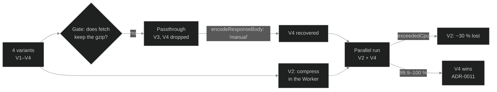

# Cloudflare capture spike

Time-boxed spike to decide whether Cloudflare Workers (Free plan, Cron Triggers) + R2 can capture the AMBici and Bicing GBFS feeds every minute, at no cost.

**Outcome:** yes, with variant V4, which stores the origin's gzip bytes unchanged. Recorded in [ADR-0011](../../docs/decisions/0011-cloudflare-workers-r2-for-realtime-capture.md). The working document, with questions, method, plan, findings and conclusion, is [cloudflare-capture-spike.md](../../docs/spikes/s006-cloudflare-capture.md).

## How we got here

The spike started with four capture variants and exit criteria fixed before the first deploy: about 95 % of the expected captures, €0 billed, and a daily download that works. Each risky assumption had a gate that could stop the plan. The first gate did: a Worker's `fetch` decodes gzip bodies, so the two variants that stored the origin's compressed bytes were dropped. Rather than settle for compressing in the Worker, the runtime's typings were searched and an undocumented option, `encodeResponseBody: 'manual'`, was found; a smoke test confirmed it and V4 was recovered. V2, which compresses in the Worker, and V4 then ran in parallel on the same feeds. Their results were checked by an analysis script that was itself verified with known arithmetic, independent counts and fault injection. The first hours looked fine for both, until the Free plan began enforcing its 10 ms CPU limit and cut V2's passes. V4 never was.



## Result

Observed window: 2026-10-14 10:51–22:09 UTC (findings F14 and F15 in the working document).

| | V2 | V4 |
|---|---|---|
| Capture per dynamic feed | 68–72 % | 99.9–100 % |
| CPU per pass | 18–48 ms, cut by `exceededCpu` | typical 5 ms, max 28 ms, never cut |
| Billed | €0 | €0 |

## Layout

```text
spikes/cloudflare-capture-spike/
├── README.md                 This file
├── js/                       V2, V4 (one Wrangler config per Worker)
│   ├── src/probe-write-once.js   Write-once probe for T039, run only locally
│   └── wrangler.probe.jsonc      Its Wrangler config
├── analysis/
│   ├── analyze_remote_capture.py
│   ├── spike-log-queries.sql     DuckDB queries over V4's logs and raw (d004 › D2)
│   ├── spike_raw_switch.py       Cutoffs, keys and counts for the switch (d004 › D11)
│   ├── capture-completeness.sql  Production's first 7 days (d004 › D6)
│   └── output/               Report, issues and switch listings (ignored by git)
└── data/                     Copy of the bucket data (ignored by git)
    ├── V2/{raw,logs,state}/
    └── V4/{raw,logs,state}/
```

## Running it

Deploy or delete a Worker, from `js/`:

```bash
npx wrangler deploy -c wrangler.v4.jsonc
npx wrangler delete -c wrangler.v4.jsonc
```

Download the bucket, from the spike root (rclone copies only new files):

```bash
rclone copy r2:bikesharing-capture-spike data
```

Analyse the capture, from the spike root. The script recomputes everything from `data/` and overwrites `analysis/output/report.md` (completeness, validity, log reconciliation, static feeds, Class A estimate) and `analysis/output/issues.csv`:

```bash
python3 analysis/analyze_remote_capture.py
```

Probe R2's write-once condition, from `js/` (against the test bucket, or against Miniflare with `--env miniflare`), then request `/`. It is never deployed:

```bash
npx wrangler dev -c wrangler.probe.jsonc
```

### Switch to production (T039)

The switch of [d004 › D11](../../docs/designs/d004-bronze-data-capture.md#d11-switch-from-spike-capture-to-production), with the tooling of [d004 › Switch tooling](../../docs/designs/d004-bronze-data-capture.md#switch-tooling). Run from the spike root; listings and the cutoffs file go to `analysis/output/`. List production before the first copy, since the cutoffs are read from it:

```bash
rclone lsf -R r2:bikesharing-bronze/raw > analysis/output/prod-before.txt
rclone lsf -R r2:bikesharing-capture-spike/V4/raw > analysis/output/spike.txt
```

Write the cutoffs (only if `analysis/output/cutoffs.json` does not exist; it is then reused unchanged) and the keys to copy; it exits 1 while a spike feed has no object in production:

```bash
python3 analysis/spike_raw_switch.py keys --prod analysis/output/prod-before.txt --spike analysis/output/spike.txt --cutoffs analysis/output/cutoffs.json --out analysis/output/keys.txt
```

Copy server-side, then list production again and compare the counts per day and feed before the cutoffs; it exits 1 on any difference, and the copy is repeated:

```bash
rclone copy --files-from analysis/output/keys.txt r2:bikesharing-capture-spike/V4/raw r2:bikesharing-bronze/raw
rclone lsf -R r2:bikesharing-bronze/raw > analysis/output/prod-after.txt
python3 analysis/spike_raw_switch.py count --prod analysis/output/prod-after.txt --spike analysis/output/spike.txt --cutoffs analysis/output/cutoffs.json
```

Once `capture-v4` has stopped, copy its last logs and run the queries of d004 › D2, from the repository root:

```bash
rclone copy r2:bikesharing-capture-spike spikes/cloudflare-capture-spike/data
duckdb -f spikes/cloudflare-capture-spike/analysis/spike-log-queries.sql
```

After production's first 7 full UTC days, list production to `analysis/output/prod-completeness.txt`, set `first_day` at the top of `capture-completeness.sql` to the day after production's first day, and run it from the repository root. It prints, per dynamic feed, the minutes with at least one object, their percentage of 10,080 and whether it is below 99.5%:

```bash
rclone lsf -R r2:bikesharing-bronze/raw > spikes/cloudflare-capture-spike/analysis/output/prod-completeness.txt
duckdb -f spikes/cloudflare-capture-spike/analysis/capture-completeness.sql
```
