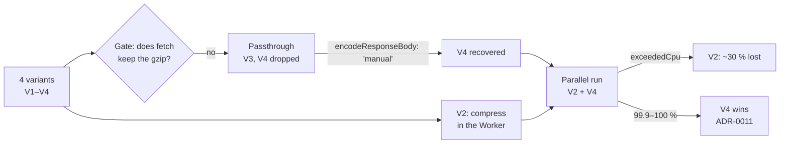

# Cloudflare capture spike

Time-boxed spike to decide whether Cloudflare Workers (Free plan, Cron Triggers) + R2 can capture the AMBici and Bicing GBFS feeds every minute, at no cost.

**Outcome:** yes, with variant V4, which stores the origin's gzip bytes unchanged. Recorded in [ADR-0011](../../docs/decisions/0011-cloudflare-workers-r2-for-realtime-capture.md). The working document, with questions, method, plan, findings and conclusion, is [cloudflare-capture-spike.md](../../docs/spikes/s006-cloudflare-capture.md).

## How we got here

The spike started with four capture variants and exit criteria fixed before the first deploy: about 95 % of the expected captures, €0 billed, and a daily download that works. Each risky assumption had a gate that could stop the plan. The first gate did: a Worker's `fetch` decodes gzip bodies, so the two variants that stored the origin's compressed bytes were dropped. Rather than settle for compressing in the Worker, the runtime's typings were searched and an undocumented option, `encodeResponseBody: 'manual'`, was found; a smoke test confirmed it and V4 was recovered. V2, which compresses in the Worker, and V4 then ran in parallel on the same feeds. Their results were checked by an analysis script that was itself verified with known arithmetic, independent counts and fault injection. The first hours looked fine for both, until the Free plan began enforcing its 10 ms CPU limit and cut V2's passes. V4 never was.



## Result

Observed window: 2026-10-14 10:51–22:09 UTC (findings F14 and F15 in the working document).

| | V2 | V4 |
|---|---|---|
| Capture per dynamic feed | 68–72 % | 99.9–100 % |
| CPU per pass | 18–48 ms, cut by `exceededCpu` | typical 5 ms, max 28 ms, never cut |
| Billed | €0 | €0 |

## Layout

```
spikes/cloudflare-capture-spike/
├── README.md                 This file
├── js/                       V2, V4 (one Wrangler config per Worker)
├── analysis/
│   ├── analyze_remote_capture.py
│   └── output/               Report and issues (ignored by git)
└── data/                     Copy of the bucket data (ignored by git)
    ├── V2/{raw,logs,state}/
    └── V4/{raw,logs,state}/
```

## Running it

Deploy or delete a Worker, from `js/`:

```
npx wrangler deploy -c wrangler.v4.jsonc
npx wrangler delete -c wrangler.v4.jsonc
```

Download the bucket, from the spike root (rclone copies only new files):

```
rclone copy r2:bikesharing-capture-spike data
```

Analyse the capture, from the spike root. The script recomputes everything from `data/` and overwrites `analysis/output/report.md` (completeness, validity, log reconciliation, static feeds, Class A estimate) and `analysis/output/issues.csv`:

```
python3 analysis/analyze_remote_capture.py
```
